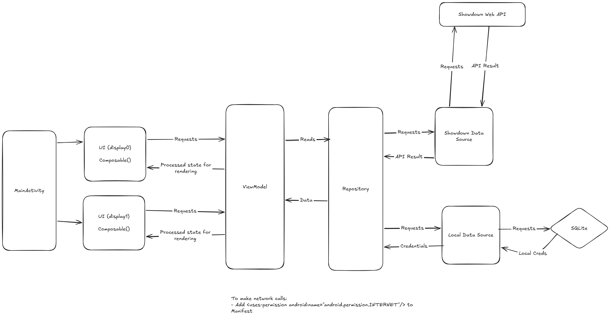

# ThorShowdown Architecture (sketch)

A Pokémon Showdown client for the AYN Thor (dual-screen Android handheld).
Status: high-level design only. Nothing here is implemented yet beyond the
"Hello World on both displays" spike in `MainActivity.kt`.

## Overview



Text version:

```
                                   Showdown servers
                          (WebSocket sim server + HTTP login)
                                         ▲ │
                          commands/login │ │ protocol messages (pushed)
                                         │ ▼
MainActivity ──hosts──▶ TopScreen ◀──┐   ShowdownDataSource
     │                               │         ▲ │
     │      Presentation ──▶ BottomScreen      │ │ raw messages
     │                         │     │         │ ▼
     └──creates──▶ GameViewModel ◀───┘   Repository ◀──▶ LocalDataSource ──▶ Room / DataStore
                    │  ▲   ▲ state            ▲ │
                    │  │   └──────────────────┘ │
                    │  └── actions/events       │ BattleState, session (StateFlow)
                    └─────── calls ─────────────┘
```

Dependencies point one way: UI → ViewModel → Repository → data sources.
Nothing to the right ever references anything to its left; data flows back as
observable state (`StateFlow` / `Flow`).

## Layers

### MainActivity (app entry point)
- Owns the top display (display 0) via `setContent { TopScreen(...) }`.
- Finds the bottom display (`DisplayManager`, first non-default display) and
  shows it as a `Presentation` running `BottomScreen(...)`.
- Creates the single `GameViewModel` shared by both screens.
- Receives gamepad input (focused window) and forwards it to the ViewModel.
- Keeps no game logic of its own.

### UI: TopScreen / BottomScreen (Compose)
- Stateless composables: render what they're given, report user actions.
- Top (display 0): battlefield, Pokémon sprites, HP bars, battle log/animations.
- Bottom (display 1, touch): move buttons, switch menu, chat, team info.
- Signature shape: `TopScreen(state: TopUiState)`,
  `BottomScreen(state: BottomUiState, onAction: (UserAction) -> Unit)`.

### GameViewModel (one, shared)
- Single source of UI truth for both displays, so they can't drift apart.
- Maps repository state to per-screen UI state: `topState`, `bottomState`.
- Turns user actions (choose move, switch, forfeit, send chat) into repository calls.
- Survives configuration changes, but not process death. Anything that must
  survive belongs in the Repository / LocalDataSource.

### Repository (app-scoped singleton)
- Lives for the whole app, not one screen, so the server connection isn't tied
  to the Activity lifecycle. Created in an `Application` subclass (later: Hilt).
- Parses the Showdown protocol (`|move|`, `|switch|`, `|request|`, ...) into
  typed models: `BattleState`, `SessionState`.
- Coordinates the login flow between the remote and local sources.
- Exposes `StateFlow`s; offers suspend functions for commands.

### ShowdownDataSource (remote)
- Mostly a persistent **WebSocket**, not request/response: the server pushes
  messages at any time (opponent moves, timers, chat).
  - Shape: `messages: Flow<String>`, `send(command: String)`, `connect()` / `disconnect()`.
- Plus a small amount of HTTP for login (exchange the server's challenge string
  for an auth assertion). Verify the current endpoint against the Showdown
  client source before implementing.
- Candidate libraries: OkHttp (WebSocket + HTTP) or Ktor client.

### LocalDataSource
- **Session/credentials:** store a session token, never the raw password.
  Encrypt at rest using the Android Keystore (DataStore + Keystore-backed encryption).
- **Teams, settings, battle logs:** Room (typed SQLite) for structured data,
  DataStore for small key/value settings.

## Diagram changes from the whiteboard draft
1. **Showdown ↔ data source is a stream, not request → result.** Draw outgoing
   arrows as "commands" and incoming as "pushed messages". Results don't line up
   one-to-one with requests.
2. **Local store holds a session token, not credentials.** "Local Creds" in
   SQLite → "Session token (encrypted)" in DataStore. Room on top of SQLite for
   everything else.

## Open questions
- Which features ship first: watching battles, playing ladder, team builder?
- Gamepad mapping: which Thor buttons map to moves/switches/confirm?
- Is the bottom screen touch-only, or also gamepad-navigable?
- Offline behavior: what is usable without a connection (team builder, replays)?
- Reconnect strategy: how to resume an in-progress battle after a dropped connection
  or process death.
- Sprites/assets: bundle, or fetch from Showdown's CDN and cache?
