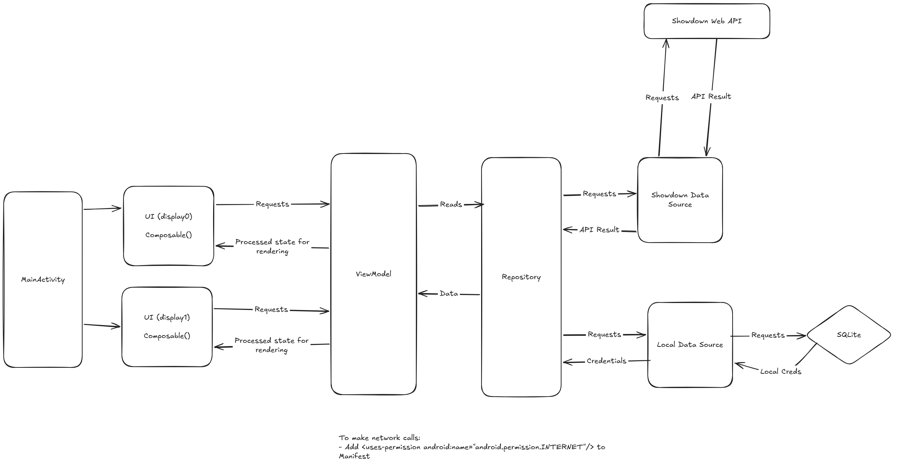

# ThorShowdown Architecture (sketch)

A Pokémon Showdown client for the AYN Thor (dual-screen Android handheld).
Status: high-level design plus stub scaffolding in `app/` (one class per box below).

## Key decision: native client + view-only WebView (option A1)

- **Native client (Repository + SessionManager + ShowdownDataSource)** owns all
  player actions and battle management: login, searching, choosing moves and
  switches, forfeits, timers.
- **Top screen is a WebView of the Showdown site**, logged in as the same user,
  so it shows exactly what the browser would (own team stats, HP, hidden info,
  tap-to-inspect tooltips). The app does no battle graphics of its own.
- **The WebView never makes choices.** Showdown's move/switch controls are hidden
  with injected CSS. Only the bottom screen sends `/choose` commands.
- Two connections to Showdown as the same user: the native WebSocket (plays) and
  the WebView (watches). Showdown allows one user on multiple connections.

See `battle_sequence.txt` (sequencediagram.org format) for the full battle flow.

## Overview



The image above is the original whiteboard draft. The text version below reflects
the current design:

```
                     ┌───────────────── Showdown servers ─────────────────┐
                     │      WebSocket sim server  +  HTTP login           │
                     └────────▲───────────┬──────────────────▲────────────┘
            commands, /choose │           │ pushed protocol  │ site connection
                       login  │           ▼ messages         │ (logged in as same user,
                     ShowdownDataSource (native)              │  view only)
                              │  ▲                            │
                     messages │  │ send()                     │
                              ▼  │                            │
 LocalDataSource ◀──▶ Repository ──owns──▶ SessionManager     │
 (DataStore/Room)        ▲   │           (BattleSession per   │
                 actions │   │ state      room ID)            │
                         │   ▼ (StateFlow)                    │
                       GameViewModel                          │
                  ┌──────────┴──────────┐                     │
          topState│                     │bottomState          │
        (roomId)  ▼                     ▼        ▲ onAction   │
   TopScreen ── hosts ── WebView ───────┼────────┼────────────┘
   (display 0)                    BottomScreen (display 1, touch)
        ▲                               ▲
        └──── MainActivity (+ Presentation for display 1) ────┘
```

Dependencies point one way: UI → ViewModel → Repository → data sources.
Nothing to the right ever references anything to its left; data flows back as
observable state (`StateFlow` / `Flow`). The WebView is the one exception that
talks to Showdown directly, and it only displays.

## Layers

### MainActivity (app entry point)
- Owns the top display (display 0) via `setContent { TopScreen(...) }`.
- Finds the bottom display (`DisplayManager`, first non-default display) and
  shows it as a `Presentation` running `BottomScreen(...)`.
- Creates the single `GameViewModel` shared by both screens.
- Receives gamepad input (focused window) and forwards it to the ViewModel.
- Keeps no game logic of its own.

### TopScreen + WebView (display 0)
- Hosts a WebView of the Showdown site (`AndroidView { WebView(...) }`).
- Logged in as the same user, so it renders the battle with full player info.
- Observes `currentRoomId` (via the ViewModel) and navigates the WebView to that
  battle room. When there's no battle, shows an idle page (lobby or home).
- Injected CSS hides everything but the battle view: move/switch controls, chat,
  menus. Tapping Pokémon for stats tooltips still works.
- **Lifetime:** create the WebView once and keep it (app-scoped or Activity-
  retained). Recreating it reloads the page and costs ~1s plus a reconnect.
- **Login:** either the user logs in once in the WebView (site cookies persist), or
  the app hands the native session to the WebView (e.g. via `CookieManager`).
  Unverified, see open questions.

### BottomScreen (display 1, touch)
- Stateless composable: move buttons, switch menu, team order, forfeit, timer.
- Built entirely from `|request|` data held in the SessionManager.
- Reports user actions via `onAction(UserAction)`. Never talks to the WebView.

### GameViewModel (one, shared)
- Single source of UI truth for both displays, so they can't drift apart.
- Maps repository state to per-screen UI state: `topState` (room to show),
  `bottomState` (available choices, waiting status).
- Turns user actions (find battle, choose move, switch, forfeit) into repository calls.
- Survives configuration changes, but not process death. Anything that must
  survive belongs in the Repository / LocalDataSource.

### Repository (app-scoped singleton)
- Lives for the whole app, not one screen, so the native connection isn't tied
  to the Activity lifecycle. Created in `ThorShowdownApp` (later: Hilt).
- Routes incoming protocol messages to the SessionManager by room ID.
- Coordinates login between the remote and local sources.
- Exposes `StateFlow`s; offers suspend functions for commands
  (`startSearch`, `chooseMove`, `switchTo`, `forfeit`).

### SessionManager (owned by Repository)
- Holds one `BattleSession` per active room ID (Showdown allows several at once).
- Each session tracks: latest `|request|` (active Pokémon, moves, switches, rqid),
  turn number, whether we're waiting on the opponent, and the result.
- Exposes `currentRoomId` and per-session `BattleState` as `StateFlow`s.
- Creates sessions on `|init|battle`, updates on `|request|` and turn events,
  ends them on `|win|` / `|tie|`.

### ShowdownDataSource (remote, native)
- Persistent **WebSocket**, not request/response: the server pushes messages at
  any time (match found, opponent moves, timers, chat).
  - Shape: `messages: Flow<String>`, `send(command: String)`, `connect()` / `disconnect()`.
- Plus a small amount of HTTP for login (exchange the server's challenge string
  for an auth assertion). See `../research/showdown_api_notes.md` for the protocol details.
- Candidate libraries: OkHttp (WebSocket + HTTP) or Ktor client.

### LocalDataSource
- **Session/credentials:** Showdown needs a fresh login (challstr → assertion) on
  every connect, and pokemon-slowdown keeps no reusable token. So either prompt
  for the password each launch, or store it encrypted with the Android Keystore.
  Whether the login server's session cookie can be reused instead is an open question.
- **Teams, settings, battle logs:** Room (typed SQLite) for structured data,
  DataStore for small key/value settings.

## Diagram changes from the whiteboard draft
1. **Showdown ↔ data source is a stream, not request → result.** Draw outgoing
   arrows as "commands" and incoming as "pushed messages". Results don't line up
   one-to-one with requests.
2. **Local store holds a session token, not credentials.** "Local Creds" in
   SQLite → "Session token (encrypted)" in DataStore. Room on top of SQLite for
   everything else.
3. **Add SessionManager** under the Repository, and **the WebView** inside the
   top UI with its own (view-only) arrow to Showdown.

## Risks
- **Site changes:** the injected CSS that hides controls depends on Showdown's page
  structure and may break when they update the site.
- **Double input:** if the CSS fails, the WebView's own move buttons reappear and
  could send a conflicting choice (or undo the native one) before the turn runs.
  Verify how the server handles a second `/choose` for the same request.
- **Two logins:** both connections must be the same account, or the WebView only
  sees spectator info.

## Open questions
- WebView login: user logs in once in the WebView, or share the native session
  with the WebView via cookies? Needs testing.
- Which features ship first: playing ladder, challenges, team builder?
- Gamepad mapping: which Thor buttons map to moves/switches/confirm?
- Is the bottom screen touch-only, or also gamepad-navigable?
- Reconnect strategy: how to resume an in-progress battle after a dropped connection
  or process death (both native and WebView).
- Idle top screen: what the WebView shows between battles.
