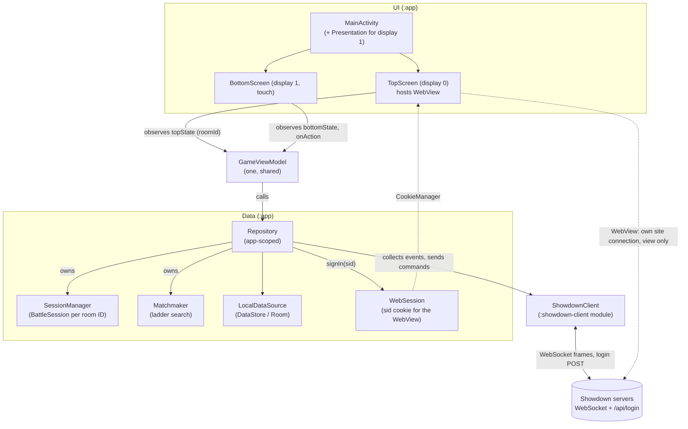
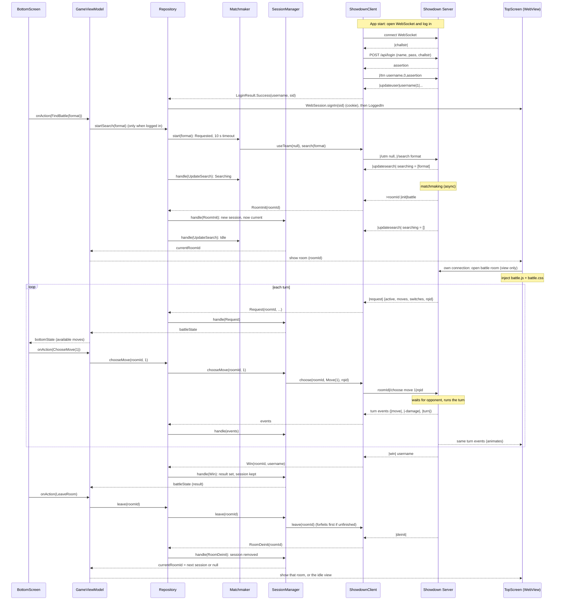

# ThorShowdown Architecture

A Pokémon Showdown client for the AYN Thor (dual-screen Android handheld).
Status: high-level design plus stub scaffolding in `app/`. Component designs:
- [showdown_client.md](showdown_client.md): the `:showdown-client` protocol library (#1).
- [login.md](login.md): login and saved credentials (#5).
- [session_manager.md](session_manager.md): battle sessions and room commands (#6).
- [battle_start.md](battle_start.md): ladder search and the start of a battle (#10).
- [webview.md](webview.md): the top-screen WebView (#4).
- [battle_menu.md](battle_menu.md): the bottom-screen battle menu (#7).
- [workflow_tests.md](workflow_tests.md): emulator workflow tests, the QA runner and reports (#16).

## Key decision: native client + view-only WebView (option A1)

- **Native client (Repository + SessionManager + ShowdownClient)** owns all
  player actions and battle management: login, searching, choosing moves and
  switches, forfeits, timers.
- **Top screen is a WebView of the Showdown site**, logged in as the same user,
  so it shows exactly what the browser would (own team stats, HP, hidden info,
  tap-to-inspect tooltips). The app does no battle graphics of its own.
- **The WebView never makes choices.** Showdown's move/switch controls are hidden
  with injected CSS. Only the bottom screen sends `/choose` commands.
- Two connections to Showdown as the same user: the native WebSocket (plays) and
  the WebView (watches). Showdown allows one user on multiple connections.

## Architecture diagram



The original whiteboard draft is kept for reference:


Dependencies point one way: UI → ViewModel → Repository → data sources / client.
Nothing references anything above it; data flows back as observable state
(`StateFlow` / `Flow`). The WebView is the one exception that talks to Showdown
directly, and it only displays.

## Battle sequence diagram

Source for sequencediagram.org: [battle_sequence.txt](battle_sequence.txt).



## Layers

### MainActivity (app entry point)
- Owns the top display (display 0) via `setContent { TopScreen(...) }`.
- Finds the bottom display (`DisplayManager`, first non-default display) and
  shows it as a `Presentation` running `BottomScreen(...)`. The bottom screen never opens dialog
  windows (they would land on the top display, and a presentation's context refuses them); its dialogs
  (forfeit, move details) are `InlineDialog`s drawn inside its own layout.
- Creates the single `GameViewModel` shared by both screens.
- Receives gamepad input (focused window) and forwards it to the ViewModel.
- Keeps no game logic of its own.

### TopScreen + WebView (display 0)
- Hosts one `BattleWebView` (`AndroidView { WebView }`) of the Showdown web client, created
  once logged in and kept; it loads `play.pokemonshowdown.com/<roomId>` for `topState.battleRoomId`
  (the current room) and `about:blank` when idle, with a native status line on top.
- Logged in as the same user via the `sid` cookie (see WebSession below), so it renders
  the battle with our side's hidden info.
- On every page load it injects `assets/webview/battle.js` + `battle.css`: hides the header,
  controls, chat, log, ads and popups, and scales the battle to fill the screen.
  It runs at document start (`androidx.webkit`), before Showdown's own scripts.
  Long-press a Pokémon for its stats tooltip.
- Navigation is locked to `https://play.pokemonshowdown.com` (`ShowdownUrls.isAllowed`).
- Details: [webview.md](webview.md); spike findings: [webview_spike.md](../research/webview_spike.md).

### BottomScreen (display 1, touch)
- Stateless composable: move buttons, switch menu, forfeit, timer, battle log.
- Built entirely from `|request|` data held in the SessionManager.
- Reports user actions via `onAction(UserAction)`. Never talks to the WebView.
- **Until #7/#8 (#10):** after login it shows a temporary lobby: "Find a Random Battle" /
  "Searching…" + Cancel, and a card for the current battle with "Leave battle"
  (an unfinished battle asks "Forfeit and leave?" first). See [battle_start.md](battle_start.md).

### GameViewModel (one, shared)
- Single source of UI truth for both displays, so they can't drift apart.
- Maps repository state to per-screen UI state: `topState` (room to show),
  `bottomState` (available choices, waiting status).
- Turns user actions (find battle, choose move, switch, forfeit) into repository calls.
- Survives configuration changes, but not process death. Anything that must
  survive belongs in the Repository / LocalDataSource.

### Composition root: ThorShowdownApp + AppContainer (#16)
- `AppContainer` holds what the network and the device provide: `Transport`, `LoginApi`,
  `CredentialStore`, `WebSession`. `DefaultAppContainer` is the real one (OkHttp, Keystore +
  DataStore, CookieManager).
- `ThorShowdownApp` builds the client and Repository from the container chosen by `AppGraph`:
  the default, unless a workflow test called `installContainer(...)` before first use.
  Installing after the repository exists throws.
- Everything above the container is real in workflow tests. First step towards Hilt.

### Repository (app-scoped singleton)
- Lives for the whole app, not one screen, so the native connection isn't tied
  to the Activity lifecycle. Created in `ThorShowdownApp` from the `AppContainer` (later: Hilt).
- Collects `ShowdownClient.events` and routes them to the SessionManager by room ID.
- Coordinates login between `ShowdownClient` and `LocalDataSource` and exposes
  `loginState`. Connects (idempotently) at the start of each login. See [login.md](login.md).
- Exposes `StateFlow`s (`loginState`, `searchState`, `sessions`); offers suspend functions
  for commands (`startSearch`, `cancelSearch`, `chooseMove`, `switchTo`, `forfeit`, `leave`).
- Sends login to the ShowdownClient itself; search commands (`useTeam`, `search`,
  `cancelSearch`) go through the Matchmaker (#10), room commands (`choose`, `forfeit`,
  `leave`) through the SessionManager (#6). `startSearch` is ignored unless logged in.
- Collects `client.events` from `init`, subscribed before any `connect()`, and hands each
  event to the Matchmaker and the SessionManager.
- After a successful login it calls `WebSession.signIn(sid)` **before** publishing `LoggedIn`,
  so the top screen is signed in by the time it appears (#4).

### WebSession (data-layer port)
- `signIn(sid)` hands the native login's `sid` cookie to the WebView. `CookieManagerWebSession`
  sets it on `.pokemonshowdown.com` (Secure) and flushes; `CookieManager` persists it.
- The `sid` never enters UI state. Clearing it on sign-out comes with logout (#8).

### Matchmaker (owned by Repository)
- Runs ladder searches (`BattleFormat`, P0: `Gen9RandomBattle`): `|/utm null` then
  `|/search`, and `|/cancelsearch`.
- Exposes `StateFlow<SearchState>`: `Idle(error)`, `Requested` (sent), `Searching`
  (confirmed). The server's `|updatesearch|` is the source of truth; `Disconnected` → `Idle`.
- While `Requested`, a `|popup|` or PM from `~` is a refusal; no reply in 10 s is
  `NoResponse`; a failed send is `SendFailed`. While `Searching`, a `|popup|` ends the
  search as `Interrupted` (the server can drop it without an `|updatesearch|`). Details: [battle_start.md](battle_start.md).
- A match needs nothing from it: the server's `|init|battle` starts the session (#6).

### SessionManager (owned by Repository)
- Holds one `BattleSession` per active room ID (Showdown allows several at once).
- Each session tracks: latest `|request|` (active Pokémon, moves, switches, rqid),
  turn number, whether we're waiting on the opponent, and the result.
- Exposes one `StateFlow<SessionsState>`: the sessions plus `currentRoomId`.
- Creates sessions on `RoomInit(battle)` (the new one becomes current), updates them on
  `Request`, `Turn`, `|error|` and `Win` / `Tie` (the result is kept for display), and
  removes them only on `|deinit|`.
- Sends room commands, filling in the latest `rqid`. `leave` forfeits an unfinished
  battle first; `selectRoom` switches rooms without leaving.
- Holds room IDs and state only, never the WebView. Details: [session_manager.md](session_manager.md).

### MoveDex (data, #7)
- Bundled move data (`assets/data/moves.json`: name, type, category, power, accuracy, priority,
  description), generated by the `:tools` module from the MIT Showdown server repo and loaded once
  in the background by `AssetMoveDex`. The ViewModel uses it for move descriptions and names.

### ShowdownClient (`:showdown-client` module)
- Standalone pure-Kotlin JVM library; no Android or app dependencies.
  Full design: [showdown_client.md](showdown_client.md).
- Owns the persistent WebSocket **and** the login HTTP exchange
  (challstr → `/api/login` → `/trn`).
- Exposes a hot `SharedFlow<ShowdownEvent>` of typed events (unknown lines kept as
  `Unparsed`) and typed commands that always send `room|cmd`.
- Does not reconnect on its own (#12), store credentials (#5) or hold battle state (#6).

### LocalDataSource
- **Credentials (#5):** username plus the password encrypted with an Android Keystore
  AES-256-GCM key, in DataStore Preferences, behind a `CredentialStore` interface.
  Showdown needs a fresh password login (challstr → assertion) on every connect.
  The `sid` cookie is not stored yet. Details in [login.md](login.md).
- **Teams, settings, battle logs:** Room (typed SQLite) for structured data,
  DataStore for small key/value settings.

## Code examples

### Layer interfaces

```kotlin
/** UI → ViewModel: everything the user can do. */
sealed interface UserAction {
    data class LogIn(val username: String, val password: String) : UserAction
    data object ContinueAsSaved : UserAction
    data object UseDifferentAccount : UserAction
    data class FindBattle(val format: BattleFormat) : UserAction
    data object CancelSearch : UserAction
    data class LeaveBattle(val roomId: String) : UserAction
    data class ChooseMove(val slot: Int, val terastallize: Boolean = false) : UserAction
    data class SwitchTo(val slot: Int) : UserAction
    data object Forfeit : UserAction
}

/** SessionManager → ViewModel: state of one battle room. */
data class BattleSession(
    val roomId: String,
    val request: BattleRequest?,   // latest |request|, null before the first one
    val turn: Int,
    val waitingForOpponent: Boolean,
    val result: BattleResult?,     // set on |win| / |tie|
)
```

### Repository wiring (app-scoped)

```kotlin
class ThorShowdownApp : Application() {
    private val graph = AppGraph { DefaultAppContainer(this, config) }

    val repository by lazy {
        val container = graph.container
        val client = DefaultShowdownClient(config, container.transport, container.loginApi, applicationScope)
        ShowdownRepository(client, LocalDataSource(container.credentialStore), container.webSession, applicationScope)
    }

    /** Workflow tests only; before first use. */
    fun installContainer(container: AppContainer) = graph.install(container)
}
```

### ViewModel turning actions into repository calls

```kotlin
fun onAction(action: UserAction) {
    viewModelScope.launch {
        when (action) {
            is UserAction.FindBattle -> repository.startSearch(action.format)
            UserAction.CancelSearch -> repository.cancelSearch()
            is UserAction.LeaveBattle -> repository.leave(action.roomId)
            is UserAction.ChooseMove -> repository.chooseMove(currentRoomId, action.slot, action.terastallize)
            is UserAction.SwitchTo -> repository.switchTo(currentRoomId, action.slot)
            UserAction.Forfeit -> repository.forfeit(currentRoomId)
        }
    }
}
```

## Diagram changes from the whiteboard draft
1. **Showdown ↔ client is a stream, not request → result.** Outgoing arrows are
   "commands" and incoming are "pushed messages". Results don't line up
   one-to-one with requests.
2. **"Showdown Data Source" is now the `ShowdownClient` module**, which also owns
   the login HTTP exchange.
3. **Local store holds an encrypted password, not plain credentials.**
   DataStore + Keystore for that; Room on top of SQLite for everything else.
4. **Add SessionManager** under the Repository, and **the WebView** inside the
   top UI with its own (view-only) arrow to Showdown.

## Risks
- **Site changes:** the injected CSS that hides controls depends on Showdown's page
  structure and may break when they update the site.
- **Double input:** if the CSS fails, the WebView's own move buttons reappear and
  could send a conflicting choice (or undo the native one) before the turn runs.
  Verify how the server handles a second `/choose` for the same request.
- **Two logins:** both connections must be the same account, or the WebView only
  sees spectator info.

## Open questions
- Gamepad mapping: which Thor buttons map to moves/switches/confirm?
- Reconnect strategy: how to resume an in-progress battle after a dropped connection
  or process death (both native and WebView).
