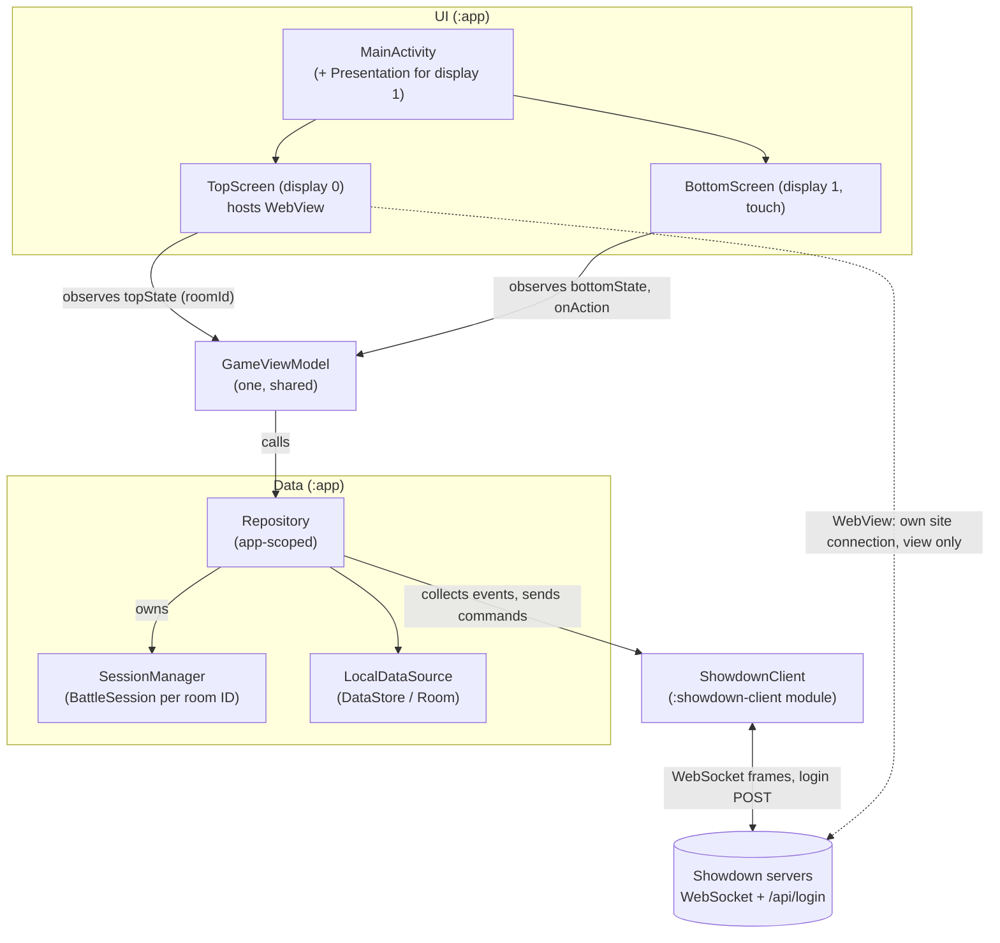
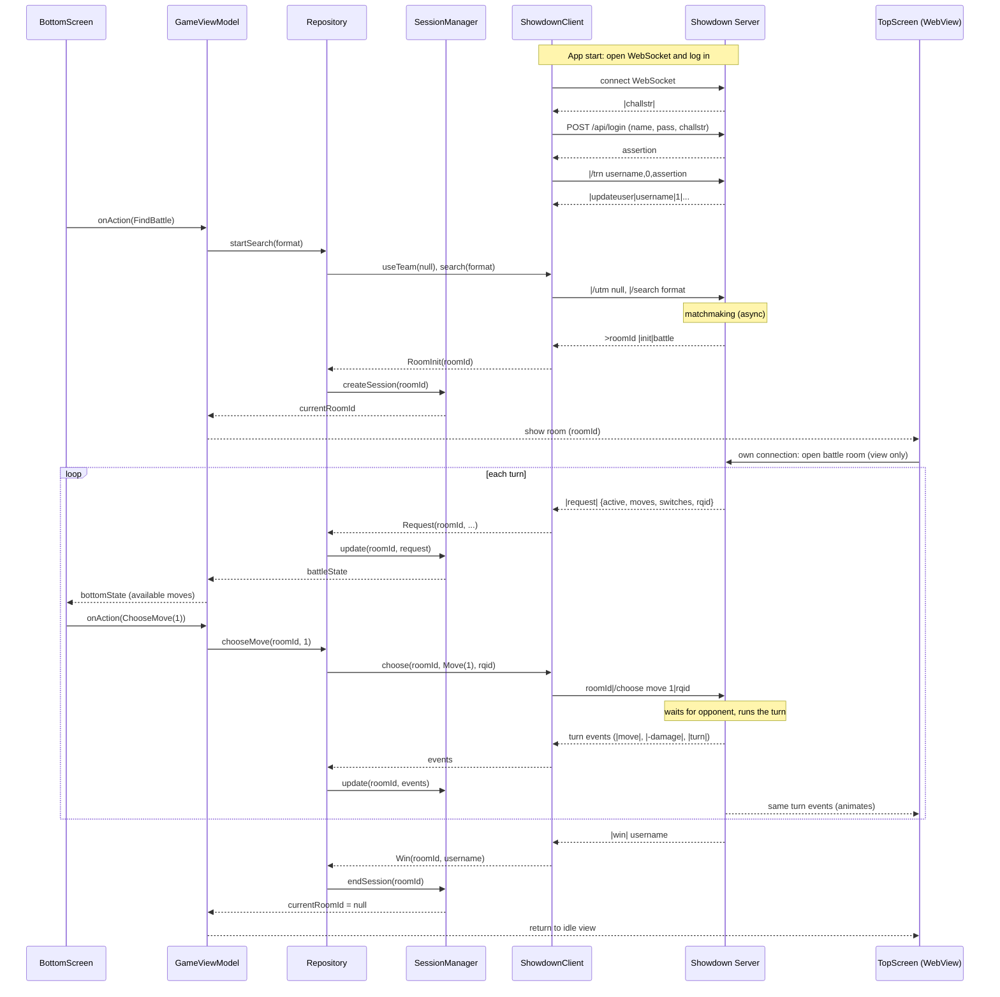

# ThorShowdown Architecture

A Pokémon Showdown client for the AYN Thor (dual-screen Android handheld).
Status: high-level design plus stub scaffolding in `app/`. Component designs:
- [showdown_client.md](showdown_client.md): the `:showdown-client` protocol library (#1).
- [login.md](login.md): login and saved credentials (#5).

## Key decision: native client + view-only WebView (option A1)

- **Native client (Repository + SessionManager + ShowdownClient)** owns all
  player actions and battle management: login, searching, choosing moves and
  switches, forfeits, timers.
- **Top screen is a WebView of the Showdown site**, logged in as the same user,
  so it shows exactly what the browser would (own team stats, HP, hidden info,
  tap-to-inspect tooltips). The app does no battle graphics of its own.
- **The WebView never makes choices.** Showdown's move/switch controls are hidden
  with injected CSS. Only the bottom screen sends `/choose` commands.
- Two connections to Showdown as the same user: the native WebSocket (plays) and
  the WebView (watches). Showdown allows one user on multiple connections.

## Architecture diagram



The original whiteboard draft is kept for reference:


Dependencies point one way: UI → ViewModel → Repository → data sources / client.
Nothing references anything above it; data flows back as observable state
(`StateFlow` / `Flow`). The WebView is the one exception that talks to Showdown
directly, and it only displays.

## Battle sequence diagram

Source for sequencediagram.org: [battle_sequence.txt](battle_sequence.txt).



## Layers

### MainActivity (app entry point)
- Owns the top display (display 0) via `setContent { TopScreen(...) }`.
- Finds the bottom display (`DisplayManager`, first non-default display) and
  shows it as a `Presentation` running `BottomScreen(...)`.
- Creates the single `GameViewModel` shared by both screens.
- Receives gamepad input (focused window) and forwards it to the ViewModel.
- Keeps no game logic of its own.

### TopScreen + WebView (display 0)
- Hosts a WebView of the Showdown site (`AndroidView { WebView(...) }`).
- Logged in as the same user, so it renders the battle with full player info.
- Observes `currentRoomId` (via the ViewModel) and navigates the WebView to that
  battle room. When there's no battle, shows an idle page (lobby or home).
- Injected CSS hides everything but the battle view: move/switch controls, chat,
  menus. Tapping Pokémon for stats tooltips still works.
- **Lifetime:** create the WebView once and keep it (app-scoped or Activity-
  retained). Recreating it reloads the page and costs ~1s plus a reconnect.
- **Login (#4):** `/api/login` sets a `sid` session cookie (`Domain=pokemonshowdown.com`,
  ~1 year). The native client exposes it (`LoginResult.Success.sid`), so the likely
  approach is handing it to the WebView via `CookieManager`. To be confirmed in the #4 spike.

### BottomScreen (display 1, touch)
- Stateless composable: move buttons, switch menu, forfeit, timer, battle log.
- Built entirely from `|request|` data held in the SessionManager.
- Reports user actions via `onAction(UserAction)`. Never talks to the WebView.

### GameViewModel (one, shared)
- Single source of UI truth for both displays, so they can't drift apart.
- Maps repository state to per-screen UI state: `topState` (room to show),
  `bottomState` (available choices, waiting status).
- Turns user actions (find battle, choose move, switch, forfeit) into repository calls.
- Survives configuration changes, but not process death. Anything that must
  survive belongs in the Repository / LocalDataSource.

### Repository (app-scoped singleton)
- Lives for the whole app, not one screen, so the native connection isn't tied
  to the Activity lifecycle. Created in `ThorShowdownApp` (later: Hilt).
- Collects `ShowdownClient.events` and routes them to the SessionManager by room ID.
- Coordinates login between `ShowdownClient` and `LocalDataSource` and exposes
  `loginState`. Connects (idempotently) at the start of each login. See [login.md](login.md).
- Exposes `StateFlow`s; offers suspend functions for commands
  (`startSearch`, `chooseMove`, `switchTo`, `forfeit`).
- Whether commands go Repository → ShowdownClient directly or via the
  SessionManager is decided in #6.

### SessionManager (owned by Repository)
- Holds one `BattleSession` per active room ID (Showdown allows several at once).
- Each session tracks: latest `|request|` (active Pokémon, moves, switches, rqid),
  turn number, whether we're waiting on the opponent, and the result.
- Exposes `currentRoomId` and per-session `BattleState` as `StateFlow`s.
- Creates sessions on `RoomInit(battle)`, updates on `Request` and turn events,
  ends them on `Win` / `Tie`.

### ShowdownClient (`:showdown-client` module)
- Standalone pure-Kotlin JVM library; no Android or app dependencies.
  Full design: [showdown_client.md](showdown_client.md).
- Owns the persistent WebSocket **and** the login HTTP exchange
  (challstr → `/api/login` → `/trn`).
- Exposes a hot `SharedFlow<ShowdownEvent>` of typed events (unknown lines kept as
  `Unparsed`) and typed commands that always send `room|cmd`.
- Does not reconnect on its own (#12), store credentials (#5) or hold battle state (#6).

### LocalDataSource
- **Credentials (#5):** username plus the password encrypted with an Android Keystore
  AES-256-GCM key, in DataStore Preferences, behind a `CredentialStore` interface.
  Showdown needs a fresh password login (challstr → assertion) on every connect.
  The `sid` cookie is not stored yet. Details in [login.md](login.md).
- **Teams, settings, battle logs:** Room (typed SQLite) for structured data,
  DataStore for small key/value settings.

## Code examples

### Layer interfaces

```kotlin
/** UI → ViewModel: everything the user can do. */
sealed interface UserAction {
    data class LogIn(val username: String, val password: String) : UserAction
    data object ContinueAsSaved : UserAction
    data object UseDifferentAccount : UserAction
    data class FindBattle(val formatId: String) : UserAction
    data class ChooseMove(val slot: Int, val terastallize: Boolean = false) : UserAction
    data class SwitchTo(val slot: Int) : UserAction
    data object Forfeit : UserAction
}

/** SessionManager → ViewModel: state of one battle room. */
data class BattleSession(
    val roomId: String,
    val request: BattleRequest?,   // latest |request|, null before the first one
    val turn: Int,
    val waitingForOpponent: Boolean,
    val result: BattleResult?,     // set on |win| / |tie|
)
```

### Repository wiring (app-scoped)

```kotlin
class ThorShowdownApp : Application() {
    val repository by lazy {
        ShowdownRepository(
            client = DefaultShowdownClient(ShowdownConfig()),
            local = LocalDataSource(this),
            scope = applicationScope,
        )
    }
}
```

### ViewModel turning actions into repository calls

```kotlin
fun onAction(action: UserAction) {
    viewModelScope.launch {
        when (action) {
            is UserAction.FindBattle -> repository.startSearch(action.formatId)
            is UserAction.ChooseMove -> repository.chooseMove(currentRoomId, action.slot, action.terastallize)
            is UserAction.SwitchTo -> repository.switchTo(currentRoomId, action.slot)
            UserAction.Forfeit -> repository.forfeit(currentRoomId)
        }
    }
}
```

## Diagram changes from the whiteboard draft
1. **Showdown ↔ client is a stream, not request → result.** Outgoing arrows are
   "commands" and incoming are "pushed messages". Results don't line up
   one-to-one with requests.
2. **"Showdown Data Source" is now the `ShowdownClient` module**, which also owns
   the login HTTP exchange.
3. **Local store holds an encrypted password, not plain credentials.**
   DataStore + Keystore for that; Room on top of SQLite for everything else.
4. **Add SessionManager** under the Repository, and **the WebView** inside the
   top UI with its own (view-only) arrow to Showdown.

## Risks
- **Site changes:** the injected CSS that hides controls depends on Showdown's page
  structure and may break when they update the site.
- **Double input:** if the CSS fails, the WebView's own move buttons reappear and
  could send a conflicting choice (or undo the native one) before the turn runs.
  Verify how the server handles a second `/choose` for the same request.
- **Two logins:** both connections must be the same account, or the WebView only
  sees spectator info.

## Open questions
- WebView login: does setting the native `sid` cookie via `CookieManager` log the
  WebView in? Test in the #4 spike.
- Commands: Repository → ShowdownClient directly, or via the SessionManager (#6)?
- Gamepad mapping: which Thor buttons map to moves/switches/confirm?
- Reconnect strategy: how to resume an in-progress battle after a dropped connection
  or process death (both native and WebView).
- Idle top screen: what the WebView shows between battles.
