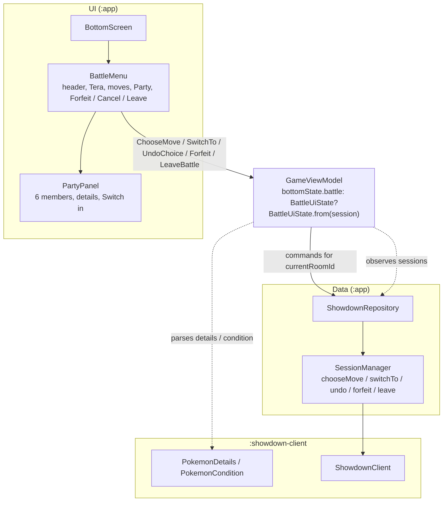
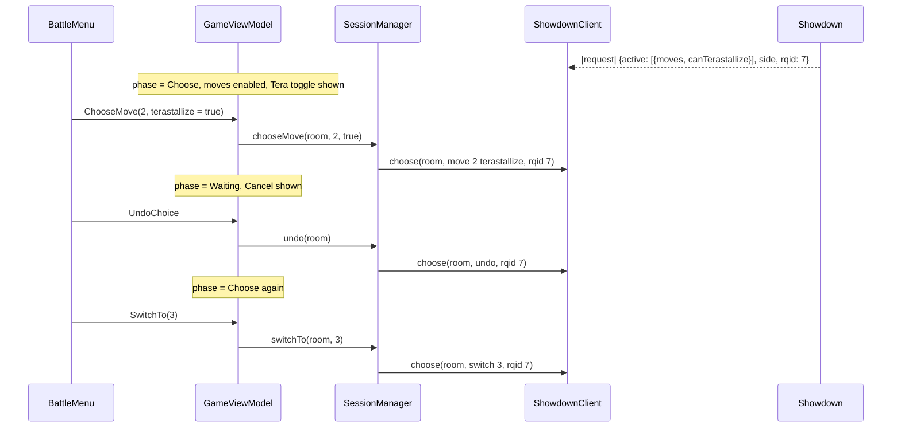
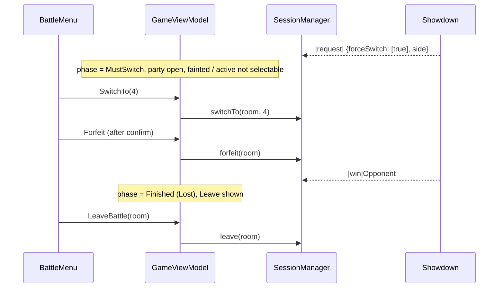

# Bottom-Screen Battle Menu

Design for the first pass of [#7 Bottom Screen Battle Functionality](https://github.com/jaydenfont/ThorShowdown/issues/7):
move selection (with Tera), party viewing, switching, undo, forfeit, and the battle timer.
Where it fits: [architecture.md](architecture.md). Sessions and commands: [session_manager.md](session_manager.md).

## Purpose

While a battle is current, the bottom screen becomes the battle menu: it shows what the latest
`|request|` allows and sends the player's choice. Everything is built from the request held in the
`BattleSession`; the top-screen WebView only displays.

## Decisions

| Topic | Decision |
|---|---|
| Scope | **In:** move grid (name, PP, disabled), Tera toggle, party view (all 6 with details), switching, forced switch, undo, forfeit (confirmed), waiting state, result + Leave, `lastError`. **Later in #7:** battle log, DS styling, move type/power, display names for items, abilities and moves (the request only has IDs), opponent team, turn timer. Team preview not needed (Random Battle). Gamepad is #9. |
| When shown | `BottomUiState.battle` is non-null while a battle is current; the bottom screen shows the battle menu instead of the lobby. The search control is hidden during a battle (the data layer still allows it; rooms UI is #8). |
| Replaces the #10 battle card | The lobby's `BattleCard` (title, result, Leave) is superseded by the battle menu's header and Finished phase, so it's removed. **Its two ViewModel tests are replaced** by `BattleUiState` tests covering the same behaviour (title shown, result shown). |
| Phase | `Finished` if `result != null`; else `Waiting` if no request yet, `request.wait`, or a choice was sent; else `MustSwitch` if any `forceSwitch`; else `Choose`. |
| Moves | From `request.active[0].moves`: enabled only in `Choose` and when the server hasn't disabled it. The server's own rules (PP, Taunt, Choice lock, Struggle) come through `disabled` / the move list. |
| Tera | Toggle shown when `active[0].canTerastallize` is set (labelled with the Tera type); applies to the next move. |
| Party | `side.pokemon` in request order (switch slots are 1-based in this order). Each shows species, level, gender, HP, status, active / fainted, item, ability, Tera type, stats, moves. Viewable in every phase. |
| Switch allowed | In `Choose` or `MustSwitch`, not fainted, not active, and (in `Choose`) not `trapped`. |
| Undo | `SessionManager.undo(roomId)` sends `/choose undo` with the current rqid when a choice was sent and the battle isn't over, then clears `waitingForOpponent` so the menu is back in `Choose`/`MustSwitch`. If the turn already ran, the server answers `|error|`, which is shown as `lastError` (existing handling); the next `|request|` follows. Shown as **Cancel** in the Waiting phase. |
| Timer | A **Timer** button in the header turns the battle timer on (`StartTimer` → `/timer on`); turn-on only. Once the server's `|inactive|` arrives the button is replaced by a countdown `⏱ 2:30 this turn · 2:30 total`, counted down once a second from the latest `Time left` reading (`countdown()`), only while it's our turn to choose (frozen while waiting), restarting on each new reading or turn; red at 30 s or less. Hidden when the battle is over. |
| Move descriptions | Long-press any move (enabled or not) for a dialog: name, Type · Category · Power · Accuracy, priority if not 0, full description, and the server's disabled reason. Data: `assets/data/moves.json`, generated by `:tools:generateMoveData` from the **MIT server repo** (`data/moves.ts` + `data/text/moves.ts`; the AGPL client repo is not used) and credited in `THIRD_PARTY.md`. `MoveDex` (`AssetMoveDex` loads it once on IO) feeds `BattleUiState.from(session, moveData)`; the party view shows move names from it too. Unknown moves show just the name. |
| Forfeit | Button with a "Forfeit this battle?" confirm → `forfeit(roomId)`. The server's `|win|` then moves the menu to `Finished`, where **Leave** (`LeaveBattle`) closes the room. |
| Actions | `ChooseMove(slot, terastallize)`, `SwitchTo(slot)`, `UndoChoice`, `Forfeit`, plus the existing `LeaveBattle(roomId)`. The ViewModel targets the current room; ignored (logged) if there is none. |
| Protocol parsing | `:showdown-client` gains `PokemonDetails.parse` (`"Eelektross, L87, M"` → species, level, gender) and `PokemonCondition.parse` (`"120/300 brn"`, `"0 fnt"` → HP, max HP, `Status`, fainted). `:app` never splits protocol strings. |

## Architecture



## Sequences

### Choose a move with Tera, then undo and switch instead



### Faint, forced switch, forfeit, leave



## Code examples

```kotlin
// :showdown-client
public data class PokemonDetails(val species: String, val level: Int, val gender: Gender?) {
    public companion object { public fun parse(details: String): PokemonDetails }
}
public enum class Gender { Male, Female }

public data class PokemonCondition(val hp: Int, val maxHp: Int?, val status: Status?, val fainted: Boolean) {
    public companion object { public fun parse(condition: String): PokemonCondition }
}
public enum class Status { Burn, Paralysis, Sleep, Freeze, Poison, Toxic }
```

```kotlin
// :app ui
enum class BattlePhase { Choose, MustSwitch, Waiting, Finished }

data class BattleUiState(
    val roomId: String,
    val title: String?,
    val turn: Int,
    val phase: BattlePhase,
    val moves: List<MoveButton>,
    val teraType: String?,          // non-null when Terastallizing is allowed
    val party: List<PartyMember>,
    val canUndo: Boolean,
    val result: BattleResult?,
    val error: String?,
) {
    companion object { fun from(session: BattleSession): BattleUiState }
}

data class MoveButton(val slot: Int, val name: String, val pp: Int, val maxPp: Int, val enabled: Boolean)

data class PartyMember(
    val slot: Int, val species: String, val level: Int, val gender: Gender?,
    val hp: Int, val maxHp: Int?, val status: Status?, val fainted: Boolean, val active: Boolean,
    val item: String, val ability: String, val teraType: String?, val stats: Stats?, val moves: List<String>,
    val canSwitchIn: Boolean,
)
```

```kotlin
// SessionManager
/** Takes back the choice sent for the current request, if the battle is still waiting on it. */
suspend fun undo(roomId: String)
```

## Testing

| Seam | Catches | Misses |
|---|---|---|
| S1 JVM `:showdown-client`: `PokemonDetails` / `PokemonCondition` | species with commas/forms, level default 100, gender, every status, fainted, HP without max | |
| S2 JVM: `BattleUiState.from(session)` | each phase, move enabling, Tera, switch eligibility (fainted, active, trapped, forced), undo availability, result, error; replay of `gen9-singles.txt` | Compose |
| S2b JVM: `SessionManager.undo` | sends undo with rqid only when a choice is pending, clears waiting, failed send | |
| S3 JVM: `GameViewModel` actions | `ChooseMove` / `SwitchTo` / `UndoChoice` / `Forfeit` reach the current room via the fake client; ignored with no battle; `battle` null when idle | |
| Manual (Thor over Wi-Fi, or emulator) | a real battle: moves, Tera, party, switch, forced switch, undo, forfeit, leave | |
