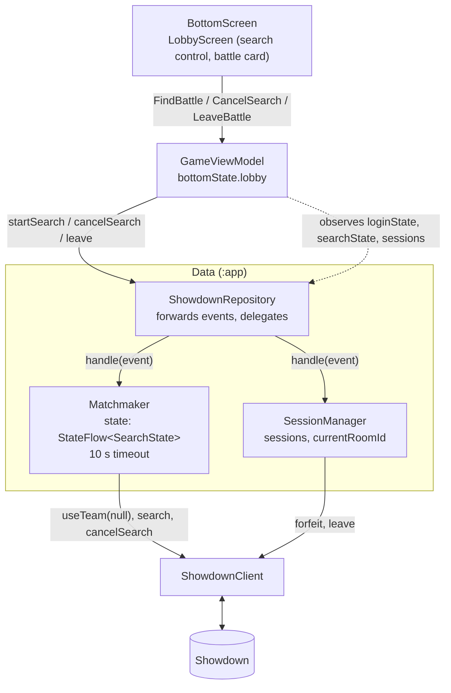
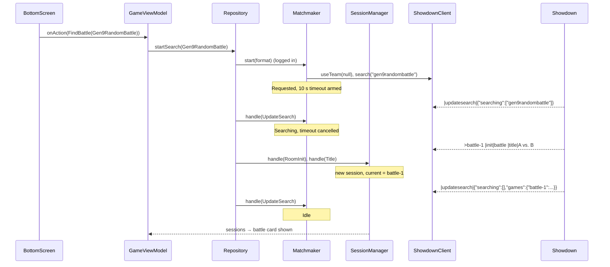
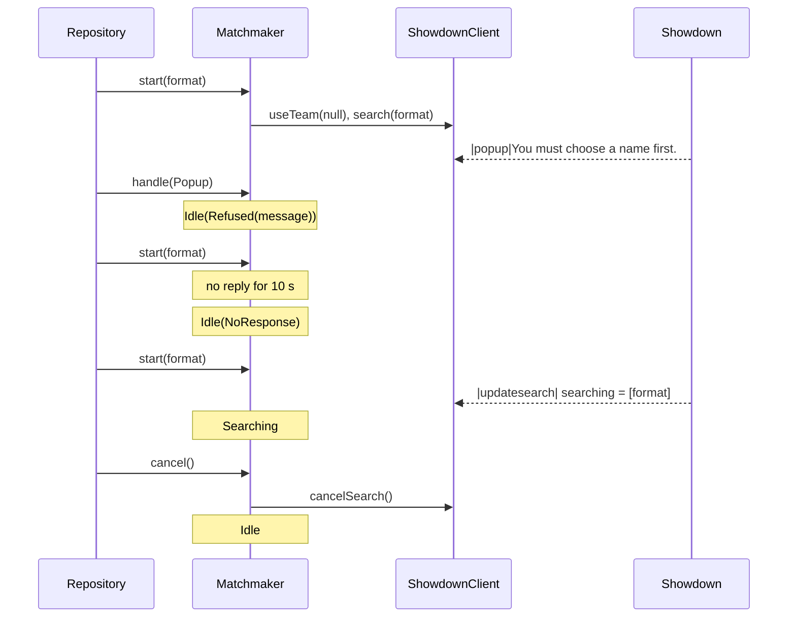

# Start of Battle

Design for [#10 Implement start of battle flow](https://github.com/jaydenfont/ThorShowdown/issues/10).
Where it fits: [architecture.md](architecture.md). Sessions: [session_manager.md](session_manager.md).
Protocol: [showdown_api_notes.md](../research/showdown_api_notes.md) (Ladder search, `|updatesearch|`).

## Purpose

Lets a logged-in user search the ladder for a Random Battle, see that the search is
running, cancel it, and land in the battle when Showdown finds a match. The battle
itself starts as a session in the SessionManager (#6); this issue adds the search
around it and a minimal bottom-screen UI to drive it.

## Decisions

| Topic | Decision |
|---|---|
| Format | `enum class BattleFormat(val id: String) { Gen9RandomBattle("gen9randombattle") }`. P0 only. Random formats need no team, so `|/utm null` comes before every `|/search`. |
| Who | A new `Matchmaker` (owned by the Repository, like `SessionManager`) holds `StateFlow<SearchState>`, handles events and sends `useTeam` / `search` / `cancelSearch`. The Repository forwards every event to it and delegates `startSearch` / `cancelSearch`. |
| State | `Idle(error: SearchError? = null)`, `Requested(format)` (sent, not yet confirmed), `Searching(format)` (the server's `|updatesearch|` lists it). |
| Source of truth | `|updatesearch|`: `searching` contains the format → `Searching`; it doesn't (cancelled, matched or dropped) → `Idle`. `Disconnected` → `Idle` (the server forgets searches with the connection). |
| Errors | While `Requested`, a `|popup|` or a PM from `~` is the refusal → `Idle(Refused(message))`, `||` turned into line breaks. No answer within 10 s → `Idle(NoResponse)`. A failed send (`IOException` / `NotConnectedException`) → `Idle(SendFailed)`. While `Searching`, any `|popup|` → `Idle(Interrupted(message))`: the server can stop a confirmed search without a later `|updatesearch|` (seen live: "your opponent … went offline before your battle could start"). Popups while idle are #11. |
| Preconditions | Only when logged in (`LoginState.LoggedIn`); otherwise logged and ignored. Ignored while `Requested` or `Searching`. Allowed while in a battle (several rooms are supported). |
| Cancel | Sends `|/cancelsearch` and goes to `Idle` at once. A late `|updatesearch|` corrects it. A no-op when `Idle`. |
| Match found | Showdown joins us to the room: `|init|battle` → SessionManager creates the session and makes it current (#6). The `|updatesearch|` with an empty `searching` returns the search to `Idle`. |
| UI (temporary) | Bottom screen, below "Logged in as X": a current-battle card (title, result, "Leave battle") and the search control ("Find a Random Battle" / "Searching…" + Cancel / error). Leaving an unfinished battle asks "Forfeit and leave?" first. The real menu is #8, battle controls #7. |
| Menu placement | #8's issue puts the main menu on the **top** screen, but #5 put login on the **bottom** screen. Recorded as an open item for #8. |
| Live test | Never searches the ladder (could match a real player). End to end is one manual battle on the emulator. |

## Architecture



## Sequences

### Search, match, battle



### Refused, timed out, cancelled



## Code examples

```kotlin
enum class BattleFormat(val id: String) { Gen9RandomBattle("gen9randombattle") }

sealed interface SearchState {
    data class Idle(val error: SearchError? = null) : SearchState
    data class Requested(val format: BattleFormat) : SearchState
    data class Searching(val format: BattleFormat) : SearchState
}

sealed interface SearchError {
    data class Refused(val message: String) : SearchError
    data class Interrupted(val message: String) : SearchError
    data object NoResponse : SearchError
    data object SendFailed : SearchError
}

class Matchmaker(private val client: ShowdownClient, private val scope: CoroutineScope) {
    val state: StateFlow<SearchState>
    fun handle(event: ShowdownEvent)
    suspend fun start(format: BattleFormat)
    suspend fun cancel()
}
```

```kotlin
class ShowdownRepository(client: ShowdownClient, local: LocalDataSource, scope: CoroutineScope) {
    private val matchmaker = Matchmaker(client, scope)
    val searchState: StateFlow<SearchState> = matchmaker.state

    init {
        scope.launch(start = CoroutineStart.UNDISPATCHED) {
            client.events.collect { matchmaker.handle(it); sessionManager.handle(it) }
        }
    }

    /** Searches for [format]; ignored unless logged in. */
    suspend fun startSearch(format: BattleFormat) {
        if (loginState.value !is LoginState.LoggedIn) return logger.warning { ... }
        matchmaker.start(format)
    }

    suspend fun cancelSearch() = matchmaker.cancel()
}
```

```kotlin
/** Bottom screen once logged in; null in BottomUiState until then. */
data class LobbyUiState(
    val search: SearchState,
    val battle: BattleCard?,        // the current session, if any
)

data class BattleCard(val roomId: String, val title: String?, val result: BattleResult?)

sealed interface UserAction {
    // ...login actions
    data class FindBattle(val format: BattleFormat) : UserAction
    data object CancelSearch : UserAction
    data class LeaveBattle(val roomId: String) : UserAction
}
```

## Testing

| Seam | Catches | Misses |
|---|---|---|
| S1 `ShowdownRepository` search (fake client emits events, virtual time) | commands sent (`/utm null` then `/search`, `/cancelsearch`), every state transition, refusal / timeout / send failure, login precondition, ignored duplicate search, searching during a battle, disconnect | the real server's popup wording |
| S2 `GameViewModel` (fake client behind a real Repository) | `lobby` null until logged in, search / battle card mapping, actions reach the Repository | Compose rendering and the confirm dialog (checked by hand) |
| Manual | one real Random Battle on the emulator: search → match → leave | |
