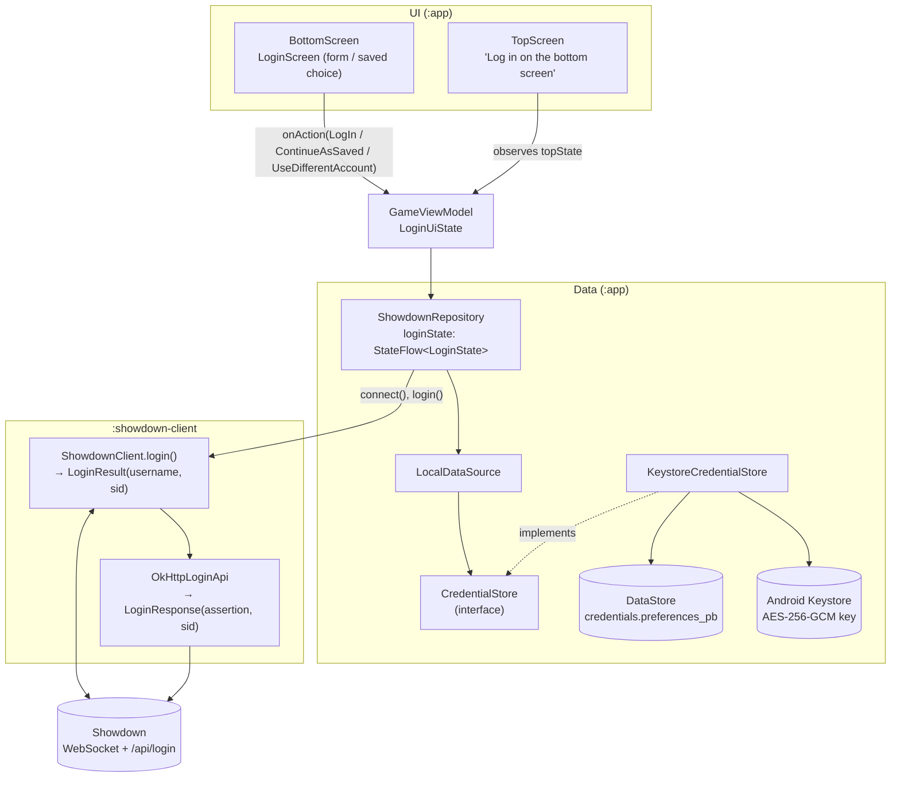
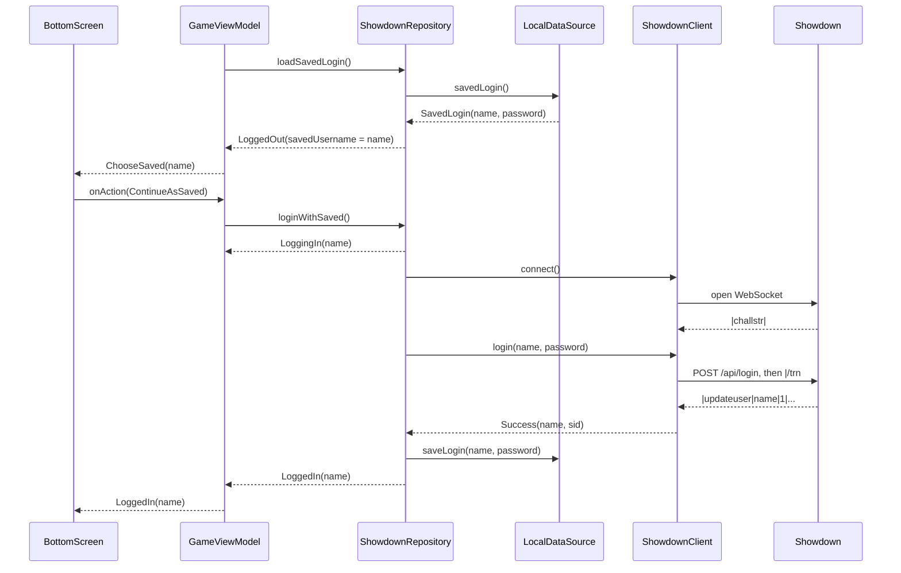
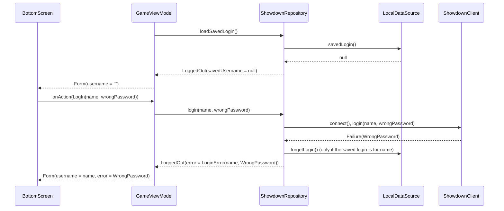

# Login

Design for [#5 Implement Login](https://github.com/jaydenfont/ThorShowdown/issues/5).
Where it fits: [architecture.md](architecture.md). Protocol: [showdown_client.md](showdown_client.md),
[showdown_api_notes.md](../research/showdown_api_notes.md).

## Purpose

On startup the user logs in on the bottom screen, either with a saved login
("Continue as NAME") or with a username and password form. A successful login is
saved on disk with the password encrypted, so the next launch is one tap.

## Decisions

| Topic | Decision |
|---|---|
| Scope | Native login (ShowdownClient) and saved credentials. **WebView login is #4**, not here: there is no WebView yet. |
| What's stored | Username (plain) and password (AES-256-GCM ciphertext). Nothing else. The `sid` cookie is **not** stored yet. |
| `sid` cookie | `/api/login` sets `sid` (`Domain=pokemonshowdown.com`, ~1 year, `Secure`). `:showdown-client` exposes it on `LoginResult.Success.sid` so #4 can hand it to the WebView via `CookieManager`. Never logged. |
| Login method | Always password: fresh challstr → `/api/login` → `/trn` on every connect. No `sid` / `/api/upkeep` login (unverified for registered accounts, and gains nothing while the password is stored). |
| Encryption | Android Keystore AES-256-GCM key (never leaves the Keystore), platform `javax.crypto` only. Stored value = Base64(IV ‖ ciphertext). |
| Storage | DataStore Preferences (`androidx.datastore:datastore-preferences`, new dependency), file `credentials`. |
| Unreadable ciphertext | E.g. after a backup restore to a new device (the Keystore key isn't backed up): logged as a warning, the saved login is cleared and treated as absent. Credentials are also excluded from backup. |
| When saved | Every successful login overwrites the saved login. No "remember me" (YAGNI); logout arrives with #8. |
| Failures | `WrongPassword` clears the saved login if it was for that name, then shows the form with the name prefilled. `NameTaken`, `Network`, `Timeout` keep the saved login so the user can retry. All shown inline. |
| Connecting | The Repository calls `client.connect()` (idempotent) at the start of each login attempt. Connecting at app start and reconnecting are #12. |
| UI | Bottom screen: saved-login choice, form, or "Logging in as NAME…". Top screen: "Log in on the bottom screen" until logged in. Failure text comes from string resources keyed by `LoginFailure`. |

## Architecture



## Sequences

### Startup with a saved login



### First launch, wrong password



## Code examples

### `:showdown-client` changes

```kotlin
/** What the login server returned. [sid] is the site session cookie, if it set one. */
data class LoginResponse(val assertion: String, val sid: String?)

interface LoginApi {
    suspend fun fetchAssertion(name: String, password: String, challstr: String): LoginResponse
}

sealed interface LoginResult {
    /** [sid] is redacted from toString so it can't leak into logs. */
    data class Success(val username: String, val sid: String?) : LoginResult
    data class Failure(val reason: LoginFailure, val message: String) : LoginResult
}
```

### Credential storage

```kotlin
/** A login saved on the device. toString redacts the password. */
data class SavedLogin(val username: String, val password: String)

/** Persists one saved login. */
interface CredentialStore {
    suspend fun load(): SavedLogin?
    suspend fun save(login: SavedLogin)
    suspend fun clear()
}

class KeystoreCredentialStore(
    private val dataStore: DataStore<Preferences>,
    private val keyAlias: String = DEFAULT_KEY_ALIAS,
) : CredentialStore { /* AES/GCM/NoPadding with a Keystore key */ }
```

### Repository login state

```kotlin
sealed interface LoginState {
    data object Loading : LoginState
    data class LoggedOut(val savedUsername: String?, val error: LoginError? = null) : LoginState
    data class LoggingIn(val username: String) : LoginState
    data class LoggedIn(val username: String) : LoginState
}

data class LoginError(val username: String, val reason: LoginFailure, val message: String)

class ShowdownRepository(private val client: ShowdownClient, private val local: LocalDataSource) {
    val loginState: StateFlow<LoginState>

    suspend fun loadSavedLogin()
    suspend fun login(username: String, password: String)
    suspend fun loginWithSaved()
}
```

### ViewModel → bottom screen

```kotlin
sealed interface LoginUiState {
    data object Loading : LoginUiState
    data class ChooseSaved(val username: String, val error: LoginError? = null) : LoginUiState
    data class Form(val username: String, val error: LoginError? = null) : LoginUiState
    data class LoggingIn(val username: String) : LoginUiState
    data class LoggedIn(val username: String) : LoginUiState
}

sealed interface UserAction {
    data class LogIn(val username: String, val password: String) : UserAction
    data object ContinueAsSaved : UserAction
    data object UseDifferentAccount : UserAction
    // ... FindBattle
}
```

`LoggedOut(saved, error)` maps to `ChooseSaved(saved, error)` when there's a saved login
and the user hasn't picked "Use a different account"; otherwise to
`Form(error?.username ?: "", error)`.

## Testing

| Seam | Catches | Misses |
|---|---|---|
| S1 `OkHttpLoginApi` vs MockWebServer | `sid` read from `Set-Cookie`; no cookie → null | Real server cookie format (live test) |
| S2 `DefaultShowdownClient.login` with fakes | `Success` carries the `sid` | as #1 |
| S3 `ShowdownRepository` (JVM, fake client + fake `CredentialStore`) | connect on login, save on success, saved path, WrongPassword clears, others keep, state transitions | real encryption |
| S4 `KeystoreCredentialStore` (instrumented, emulator) | save/load/clear round-trip, no plaintext on disk | Thor's own Keystore; not in CI |
| S5 `GameViewModel` (JVM, `Dispatchers.setMain`) | saved choice vs form, "different account", logging-in state, errors | Compose rendering (manual on emulator) |

## Out of scope
- WebView login with the `sid` cookie: [#4](https://github.com/jaydenfont/ThorShowdown/issues/4).
- Logout and the main menu: [#8](https://github.com/jaydenfont/ThorShowdown/issues/8).
- Automatic login on reconnect: [#12](https://github.com/jaydenfont/ThorShowdown/issues/12).
