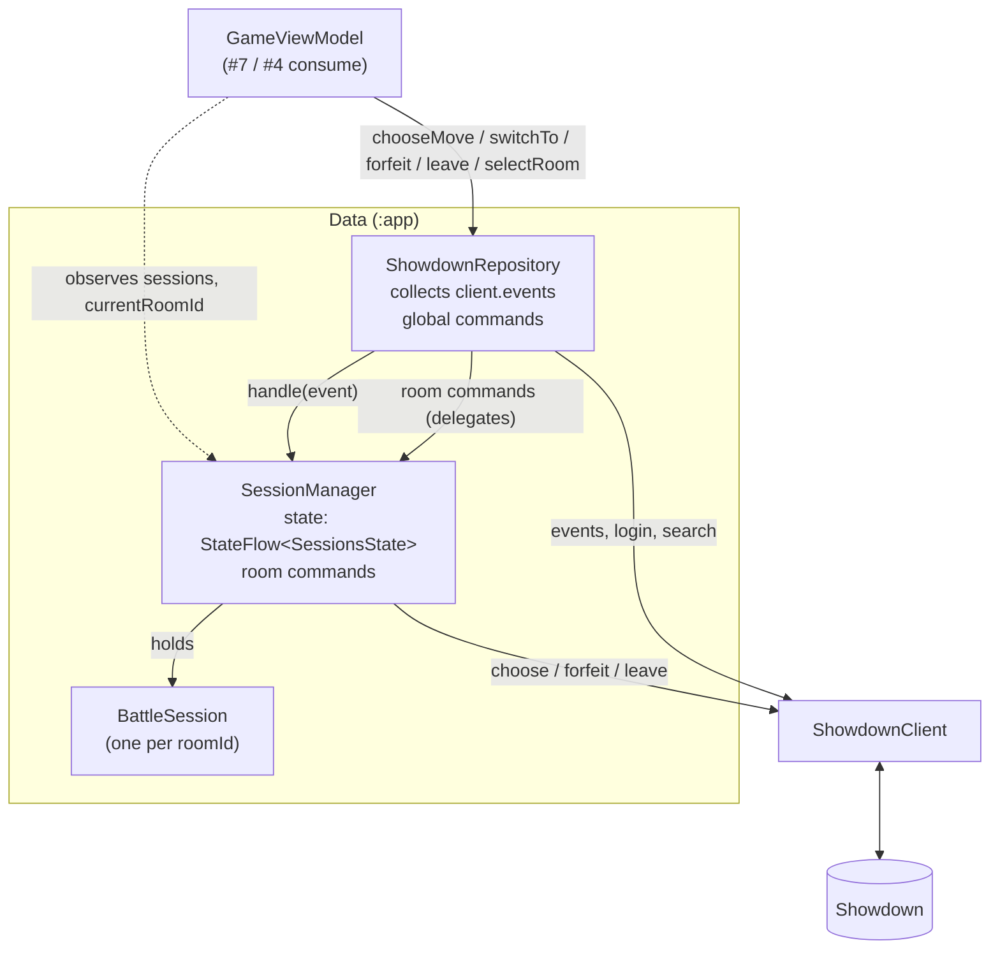
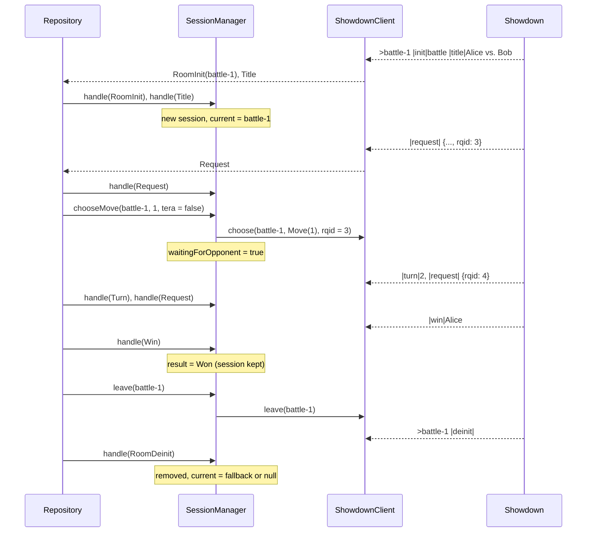
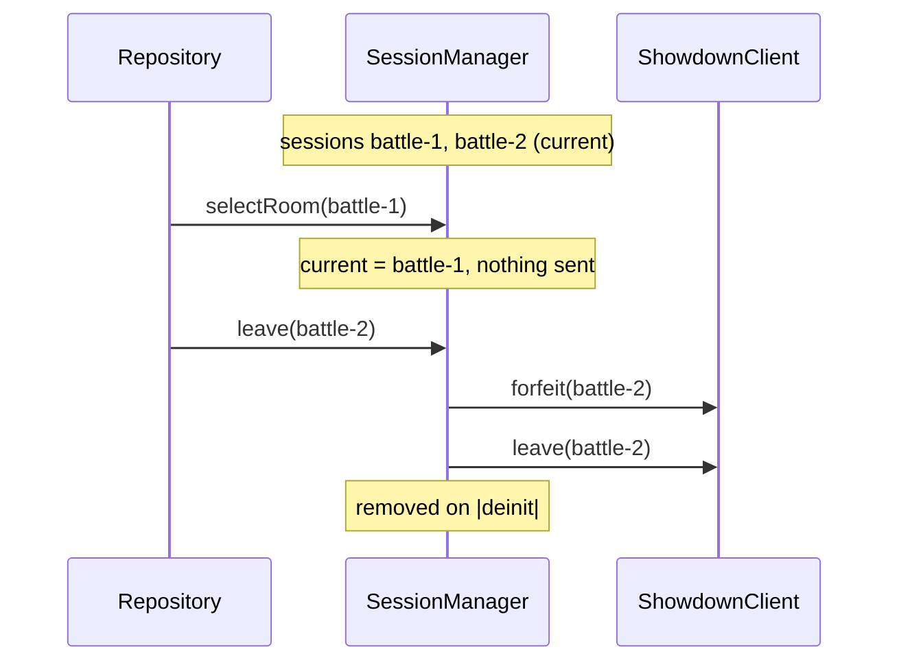

# Session Manager

Design for [#6 Implement Showdown Session Manager](https://github.com/jaydenfont/ThorShowdown/issues/6).
Where it fits: [architecture.md](architecture.md). Events and commands: [showdown_client.md](showdown_client.md).

## Purpose

Tracks every battle room the user is in, one `BattleSession` per room ID, and sends the
commands that belong to a room (`/choose`, `/forfeit`, `/leave`). It knows which room
is current, so the top screen (#4) and bottom screen (#7) always show the same battle.

## Decisions

| Topic | Decision |
|---|---|
| Who sends what | **SessionManager:** room commands `choose`, `forfeit`, `leave`. It fills in the latest `rqid`. **Repository:** global commands (login, `useTeam`, `search`). |
| Event flow | The Repository collects `client.events` from `init` (started `UNDISPATCHED` on the app scope, so it's subscribed before any `connect()`) and calls `sessionManager.handle(event)`. `handle` is a plain synchronous state update. |
| Created | On `RoomInit(BATTLE)`. Chat rooms are ignored. The new session **becomes current**. |
| Updated | `Title` → title. `Request` → request, `waitingForOpponent = request.wait`, clears `lastError`. `Turn` → turn. `BattleError` → `lastError`, and `waitingForOpponent = false` so the player can choose again. `Win`/`Tie` → `result`. Events for unknown rooms are logged and ignored. |
| Finished battles | Keep their session (with `result`) so the result can be shown. They go away only when the player leaves. |
| Removed | On `RoomDeinit` only: the server is the source of truth. |
| Leaving | `leave(roomId)`: an unfinished battle is **forfeited first**, then `/leave`. A finished one just leaves. |
| Switching | `selectRoom(roomId)` only changes which room is current. It **never** leaves or forfeits. Unknown room IDs are logged and ignored. |
| Fallback | When the current room is removed, the most recently created remaining session becomes current, or null if none. |
| Choice guard | `chooseMove` / `switchTo` send only when the session has a request awaiting a choice (not `wait`, not already chosen). Otherwise logged and ignored. Move legality is left to the server and #7's UI. `forfeit` / `leave` always send. |
| Send failures | Client `IOException` / `NotConnectedException` are caught, logged and shown as `lastError`; the session isn't marked as waiting. Reconnect is #12. |
| Timer (#7) | `startTimer(roomId)` sends `/timer on`. Any `Inactive` sets `timerOn`; a `Time left: N sec this turn | M sec total` message (parsed by `TimeLeft.parse` in `:showdown-client`) replaces `timeLeft`, other timer messages (announcements, opponent warnings) leave it. `InactiveOff` clears both. The server decides; the button doesn't flip state. |
| Result | `Won` / `Lost` / `Tied`. "Us" is `request.side.name`, compared as a Showdown ID. |
| WebView | Only room IDs and session state are exposed; the WebView object is never held here (#4 observes `currentRoomId`). |
| State | One `StateFlow<SessionsState>` holding both the sessions and `currentRoomId`, so they can never be seen out of step. Updates use atomic `update {}`. |
| Out of scope | ViewModel/UI (#7, #4, #10), battle log (#7), reconnect/rejoin (#12): `Disconnected` leaves sessions alone. |

## Architecture



## Sequences

### A battle from start to leaving



### Leaving an unfinished battle, and switching rooms



## Code examples

```kotlin
data class BattleSession(
    val roomId: String,
    val title: String? = null,
    val request: BattleRequest? = null,
    val turn: Int = 0,
    val waitingForOpponent: Boolean = false,
    val lastError: String? = null,
    val result: BattleResult? = null,
) {
    val awaitingChoice: Boolean get() = request != null && !request.wait && !waitingForOpponent && result == null
}

enum class BattleResult { Won, Lost, Tied }

/** Sessions in creation order, plus the one being shown. */
data class SessionsState(
    val sessions: Map<String, BattleSession> = emptyMap(),
    val currentRoomId: String? = null,
)

class SessionManager(private val client: ShowdownClient) {
    val state: StateFlow<SessionsState>

    fun handle(event: ShowdownEvent)
    fun selectRoom(roomId: String)

    suspend fun chooseMove(roomId: String, slot: Int, terastallize: Boolean)
    suspend fun switchTo(roomId: String, slot: Int)
    suspend fun forfeit(roomId: String)
    suspend fun leave(roomId: String)   // forfeits first if unfinished
}
```

```kotlin
class ShowdownRepository(client: ShowdownClient, local: LocalDataSource, scope: CoroutineScope) {
    private val sessionManager = SessionManager(client)
    val sessions: StateFlow<SessionsState> = sessionManager.state

    init {
        scope.launch(start = CoroutineStart.UNDISPATCHED) {
            client.events.collect(sessionManager::handle)
        }
    }

    suspend fun chooseMove(roomId: String, slot: Int, terastallize: Boolean) =
        sessionManager.chooseMove(roomId, slot, terastallize)
    // ... switchTo, forfeit, leave, selectRoom delegate the same way
}
```

`toId` (Showdown's name → ID rule) is now public in `:showdown-client` so the result can
compare names the same way the server does.

```text
Choice guard: chooseMove/switchTo atomically "claim" the request (set waitingForOpponent)
before sending, so two quick taps can't both send; a failed send releases the claim.
```

## Testing

| Seam | Catches | Misses |
|---|---|---|
| S1 `SessionManager` (`handle` + commands, fake client records room commands) | lifecycle, request/wait/error, results, choice guard, forfeit-then-leave, select and fallback | real protocol sequences |
| S2 `ShowdownRepository` wiring (fake client emits events) | events reach sessions, subscribed before `connect()`, room commands delegate | as S1 |
| S3 transcript replay (`gen9-singles.txt`, MIT, copied to `:app` test resources) | real server ordering (request before the turn log), final turn and result | multi-room |
