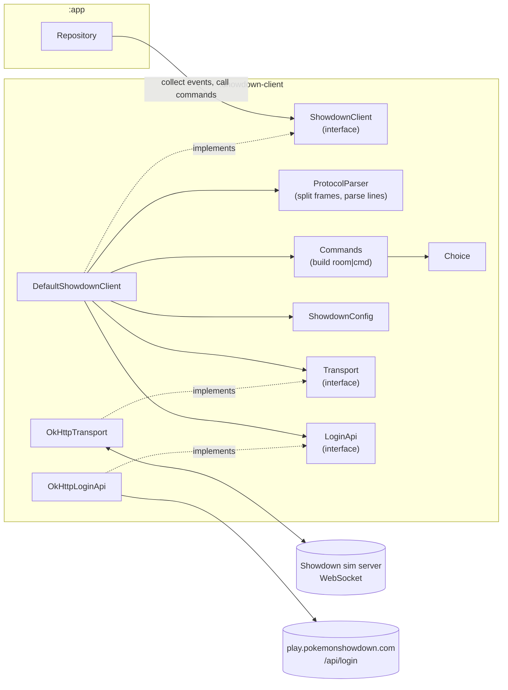
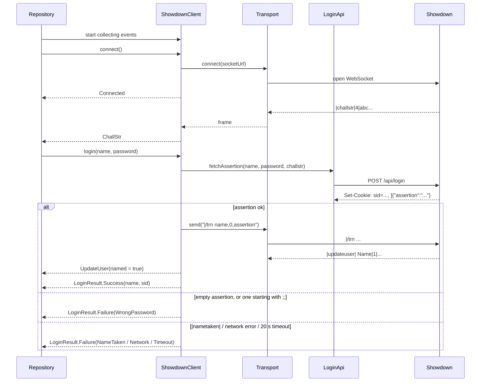
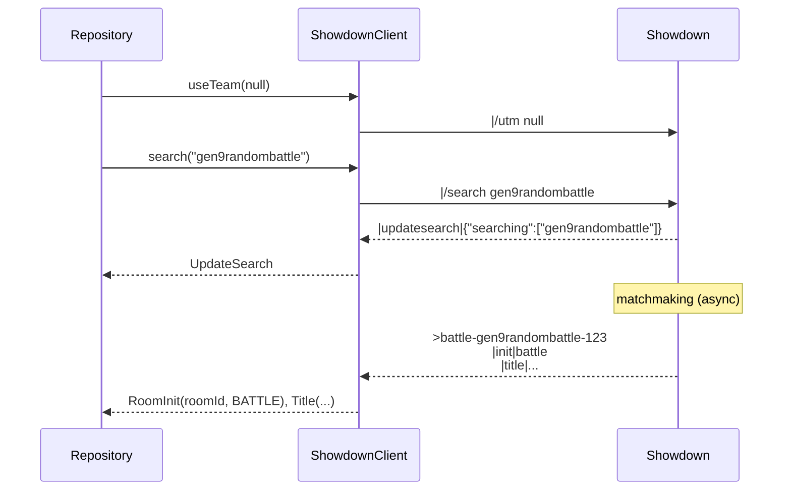
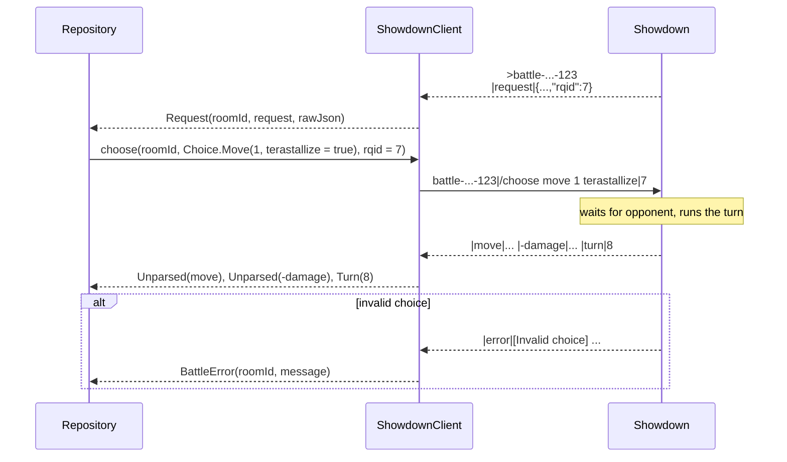

# Showdown Client (`:showdown-client`)

Design for [#1 Implement Showdown App Client](https://github.com/jaydenfont/ThorShowdown/issues/1).
Protocol background: [showdown_api_notes.md](../research/showdown_api_notes.md).
Where it fits in the app: [architecture.md](architecture.md).

## Purpose

A standalone, pure-Kotlin JVM library that speaks the Pokémon Showdown protocol:
it opens the WebSocket, logs in, turns raw server messages into typed events and
turns typed commands into correctly framed protocol strings. It knows nothing
about Android, the UI or battle state.

## Decisions

| Topic | Decision |
|---|---|
| Module | Pure-Kotlin JVM Gradle module `:showdown-client`, package `com.example.thorshowdown.showdown`. `app` depends on it; it depends on nothing in `app`. |
| Dependencies | OkHttp (WebSocket + login POST), kotlinx.serialization JSON, kotlinx.coroutines. |
| Scope | Connect/disconnect, frame splitting + parsing, command building, login. **Not** reconnect/backoff (#12), credential storage (#5, see [login.md](login.md)), battle state (#6). |
| Events | Hot `SharedFlow<ShowdownEvent>`, 1024-event buffer, suspends when full. Contract: **collect before `connect()`**. |
| Typed events | `Connected`, `Disconnected`, `ChallStr`, `UpdateUser`, `NameTaken`, `UpdateSearch`, `Popup`, `PrivateMessage`, `RoomInit`, `RoomDeinit`, `Title`, `Request`, `Turn`, `Win`, `Tie`, `BattleError`, `Inactive`, `InactiveOff`. Everything else: `Unparsed(roomId, type, args, tags)`. Nothing is dropped. |
| Login | `suspend login(name, password): LoginResult`. Waits for this connection's challstr, 20 s timeout. `;;`-prefixed or empty assertion = `WrongPassword`. `Success` carries the `sid` session cookie from `/api/login` (for the WebView, #4); it is never logged. |
| Commands | Return `Unit`; throw `NotConnectedException` with no open socket. Server rejections arrive as events (`BattleError`, `Popup`, `PrivateMessage` from `~`). |
| Choices | `Choice.Move(slot, terastallize)`, `Choice.Switch(slot)`, `Choice.Default`, `Choice.Undo` (singles, gen9randombattle P0). |
| `\|request\|` | Typed P0 fields + the raw JSON string. Unknown keys ignored. `disabled` is bool-or-reason. |
| Config | `ShowdownConfig` data class: socket URL, login URL, User-Agent, timeouts. Protocol strings live in one `Protocol` constants object. |
| Logging | `java.util.logging`. Passwords and assertions are never logged; outbound `/trn` is redacted. |
| Testing | Four seams. **S1** `ProtocolParser`: pure unit tests incl. the MIT-licensed pokemon-slowdown transcript. **S2** `ShowdownClient` with hand-written fake `Transport` / `LoginApi` (the fake server rejects frames without `room\|`); command builders are `internal` and tested through it. **S3** `OkHttpLoginApi` against OkHttp's MockWebServer (a real local HTTP server). **S4** opt-in live test (`:showdown-client:liveTest`, own source set, never in `test` or CI); it doesn't search the ladder, so it can't be matched against a real player. `OkHttpTransport` is covered only by S4. |

## Architecture



- `DefaultShowdownClient` composes the pieces; it has no protocol knowledge of its own
  beyond "run the login exchange when asked".
- `ProtocolParser` and `Commands` are pure functions with no I/O. `ProtocolParser` is
  public and tested directly; `Commands` is internal and tested through the client.
- `Transport` and `LoginApi` are the only seams to the network. Tests replace them with
  in-memory fakes; production uses the OkHttp implementations.

## Sequences

### Connect and log in



### Search for a battle



### One turn



## Code examples

### Public API

```kotlin
/** Pokémon Showdown protocol client. Collect [events] before calling [connect]. */
interface ShowdownClient {
    val events: SharedFlow<ShowdownEvent>

    suspend fun connect()
    suspend fun disconnect()
    suspend fun login(name: String, password: String): LoginResult

    suspend fun useTeam(packedTeam: String?)
    suspend fun search(formatId: String)
    suspend fun cancelSearch()
    suspend fun choose(roomId: String, choice: Choice, rqid: Int?)
    suspend fun forfeit(roomId: String)
    suspend fun join(roomId: String)
    suspend fun leave(roomId: String)
}

sealed interface LoginResult {
    data class Success(val username: String, val sid: String?) : LoginResult  // toString redacts sid
    data class Failure(val reason: LoginFailure, val message: String) : LoginResult
}

enum class LoginFailure { NotConnected, WrongPassword, NameTaken, Network, Timeout }
```

### Network seams

```kotlin
/** A text-frame socket. The only way the client touches the WebSocket. */
interface Transport {
    val incoming: Flow<TransportEvent>
    suspend fun open(url: String)
    suspend fun send(text: String)
    suspend fun close()
}

sealed interface TransportEvent {
    data class Message(val text: String) : TransportEvent
    data class Closed(val reason: String?) : TransportEvent
}

/** Exchanges credentials + challstr for a login assertion. */
interface LoginApi {
    suspend fun fetchAssertion(name: String, password: String, challstr: String): LoginResponse
}

/** [sid] is the `sid` cookie from `Set-Cookie`, kept URL-encoded as sent; null if absent. */
data class LoginResponse(val assertion: String, val sid: String?)
```

### Events and choices

```kotlin
sealed interface ShowdownEvent {
    val roomId: String          // "" for global events

    data class ChallStr(val challstr: String) : ShowdownEvent { override val roomId = "" }
    data class RoomInit(override val roomId: String, val type: RoomType) : ShowdownEvent
    data class Request(override val roomId: String, val request: BattleRequest, val rawJson: String) : ShowdownEvent
    data class Turn(override val roomId: String, val number: Int) : ShowdownEvent
    data class Unparsed(
        override val roomId: String,
        val type: String,
        val args: List<String>,
        val tags: Map<String, String>,
    ) : ShowdownEvent
    // ... Connected, Disconnected, UpdateUser, NameTaken, UpdateSearch, Popup,
    //     PrivateMessage, RoomDeinit, Title, Win, Tie, BattleError, Inactive, InactiveOff
}

sealed interface Choice {
    data class Move(val slot: Int, val terastallize: Boolean = false) : Choice
    data class Switch(val slot: Int) : Choice
    data object Default : Choice
    data object Undo : Choice
}
```

### Parsing a raw frame

```kotlin
val raw = ">battle-gen9randombattle-123\n|turn|8\n|-damage|p2a: Gengar|50/100\n"

ProtocolParser.parse(raw)
// [
//   Turn(roomId = "battle-gen9randombattle-123", number = 8),
//   Unparsed(roomId = "battle-gen9randombattle-123", type = "-damage",
//            args = ["p2a: Gengar", "50/100"], tags = {}),
// ]
```

### What commands send

The command builders are `internal`; callers use the `ShowdownClient` methods, which
send exactly these frames:

```kotlin
client.search("gen9randombattle")
// sends "|/search gen9randombattle"            (global: empty room, leading pipe)

client.choose("battle-gen9randombattle-123", Choice.Move(1, terastallize = true), rqid = 7)
// sends "battle-gen9randombattle-123|/choose move 1 terastallize|7"
```

### Wiring it up in the app

```kotlin
val config = ShowdownConfig()
val client = DefaultShowdownClient(config, OkHttpTransport(config), OkHttpLoginApi(config), applicationScope)
```

### Using it from the Repository

```kotlin
class ShowdownRepository(private val client: ShowdownClient, scope: CoroutineScope) {
    init {
        scope.launch {
            client.events
                .onSubscription { client.connect() }   // connect only once subscribed
                .collect(::route)
        }
    }

    suspend fun chooseMove(roomId: String, slot: Int, rqid: Int) =
        client.choose(roomId, Choice.Move(slot), rqid)
}
```

## Out of scope (tracked elsewhere)
- Reconnect with backoff, rejoining rooms: [#12](https://github.com/jaydenfont/ThorShowdown/issues/12).
- Per-room battle state: [#6](https://github.com/jaydenfont/ThorShowdown/issues/6).
- Teams other than `null` (packed format), challenges, doubles, other gimmicks: when a feature needs them.
