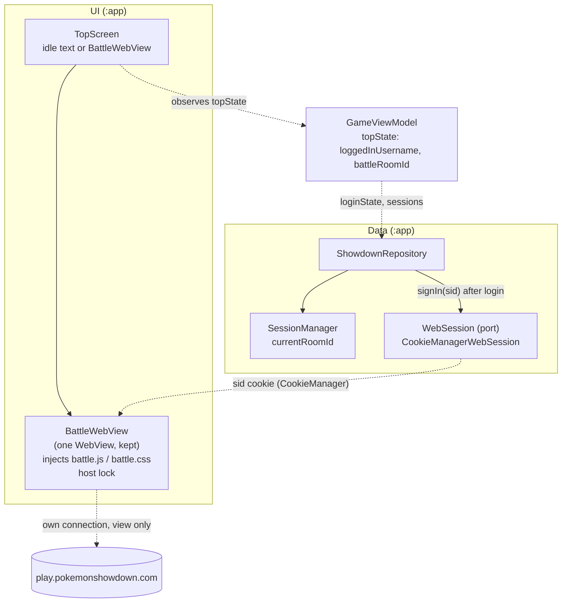
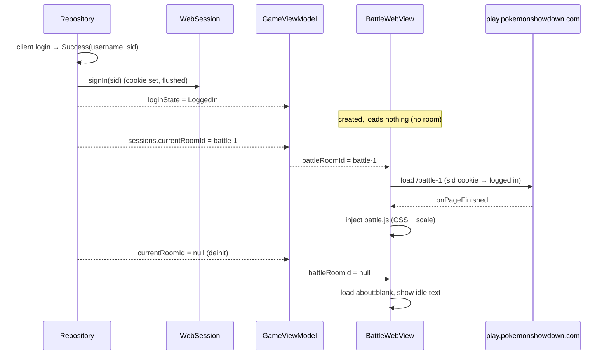
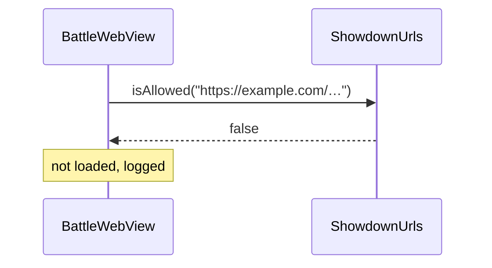

# Top-Screen WebView

Design for [#4 WebView viewer for top screen](https://github.com/jaydenfont/ThorShowdown/issues/4).
Where it fits: [architecture.md](architecture.md). Spike findings: [webview_spike.md](../research/webview_spike.md).

## Purpose

Shows the current battle on the top screen as Showdown's own web client renders it, logged in as
the user so our side's hidden info is visible. It is **view only**: Showdown's controls are hidden,
the app never sends commands through it, and the only interaction is long-pressing a Pokémon for
its stats.

## Decisions

| Topic | Decision |
|---|---|
| Login | A data-layer `WebSession` port: `suspend fun signIn(sid: String)`. `CookieManagerWebSession` sets `sid` on `.pokemonshowdown.com` (Secure, Path=/) and flushes. The Repository calls it after a successful login, **before** `LoggedIn` is published, so "logged in" means the WebView is ready. No `sid` (unexpected) → logged, WebView shows as a spectator. The `sid` never enters UI state. |
| Cookie storage | `CookieManager` keeps it on disk (normal browser behaviour). Clearing on sign-out comes with logout (#8). |
| What it shows | `TopUiState.battleRoomId` = the session manager's `currentRoomId` while logged in. Null → `about:blank` (drops its connection) and the native idle text. |
| Changing rooms | Load `https://play.pokemonshowdown.com/<roomId>` (≈1.3 s + ≈2 s WebView re-login). Not Showdown's in-page JS. |
| Lifetime | One WebView, created with the top screen and kept (`remember`); hidden, not destroyed, when idle. Nothing loads before login. |
| Injection | `assets/webview/battle.js` (which adds `battle.css` and scales `.battle` to `min(W / 640, H / 360)`, recomputed on `resize` and `DOMContentLoaded`) is registered with `androidx.webkit`'s `WebViewCompat.addDocumentStartJavaScript` for the web client origin, so it runs **before Showdown's own scripts** on every page and its controls never appear unstyled. Fallback when unsupported: `evaluateJavascript` on `onPageCommitVisible`. **Not** `onPageFinished`: found live that the load event can come ~52 s late while ads load, leaving Showdown's move buttons usable. |
| Console | A `WebChromeClient` swallows console messages: Showdown logs the whole protocol (our team) to the console, which would otherwise reach logcat. DevTools still sees them in debug builds. |
| Dependency | `androidx.webkit` 1.12.1 (approved), for document-start scripts. |
| Hidden | Header and tabs, `.battle-controls`, chat and log, ads, Showdown popups and overlays (the app shows server popups itself, #11). |
| Interaction | Long press for tooltips (Showdown's touch behaviour); #4's "tap" wording to be updated. |
| Navigation lock | `shouldOverrideUrlLoading` allows only `https://play.pokemonshowdown.com`. Everything else is blocked and logged. |
| Debugging | `setWebContentsDebuggingEnabled` in debug builds only. |
| Later | Bottom-screen control of Showdown display options (2D/3D sprites, etc.). Recorded in the workplan. |

## Architecture



## Sequences

### Login, battle starts, battle ends



### Blocked navigation



## Code examples

```kotlin
/** Signs the top-screen WebView in as the native user. */
interface WebSession {
    suspend fun signIn(sid: String)
}

class CookieManagerWebSession(private val cookies: CookieManager = CookieManager.getInstance()) : WebSession {
    override suspend fun signIn(sid: String) { /* setCookie(..., ValueCallback) + flush() */ }
}

/** Showdown web client URLs and the host lock. Pure, JVM-tested. */
object ShowdownUrls {
    fun roomUrl(roomId: String?): String          // null → "about:blank"
    fun isAllowed(url: String): Boolean           // https + play.pokemonshowdown.com only
}

data class TopUiState(
    val loggedInUsername: String? = null,
    val battleRoomId: String? = null,             // what the WebView shows; null = idle
)
```

```kotlin
// ShowdownRepository
private suspend fun onLoggedIn(login: SavedLogin, displayName: String, sid: String?) {
    local.saveLogin(login)
    if (sid != null) webSession.signIn(sid) else logger.warning { "No sid; the top screen will be a spectator" }
    _loginState.value = LoginState.LoggedIn(displayName)
}
```

```kotlin
@Composable
fun BattleWebView(roomId: String?, modifier: Modifier) {
    val webView = remember { createLockedWebView(context, injectedScript = assets("webview/battle.js")) }
    AndroidView({ webView }, modifier) { it.loadIfChanged(ShowdownUrls.roomUrl(roomId)) }
}
```

## Testing

| Seam | Catches | Misses |
|---|---|---|
| S1 JVM: `ShowdownUrls` | room URL, `about:blank` when idle, host lock (scheme, host, look-alike hosts) | |
| S1 JVM: Repository with a `FakeWebSession` | `signIn(sid)` happens before `LoggedIn`; no `sid` → not called, still logged in; failed login → not called | real cookie |
| S1 JVM: `GameViewModel` | `battleRoomId` follows `currentRoomId` while logged in, null when logged out or idle | Compose / WebView |
| S2 instrumented (emulator): `CookieManagerWebSession` | cookie readable for `https://play.pokemonshowdown.com` after `signIn` | Showdown accepting it |
| Manual (emulator) | real login in the page, CSS, scaling, long-press tooltips, idle and room changes; plus the deferred #10 end-to-end battle | |
