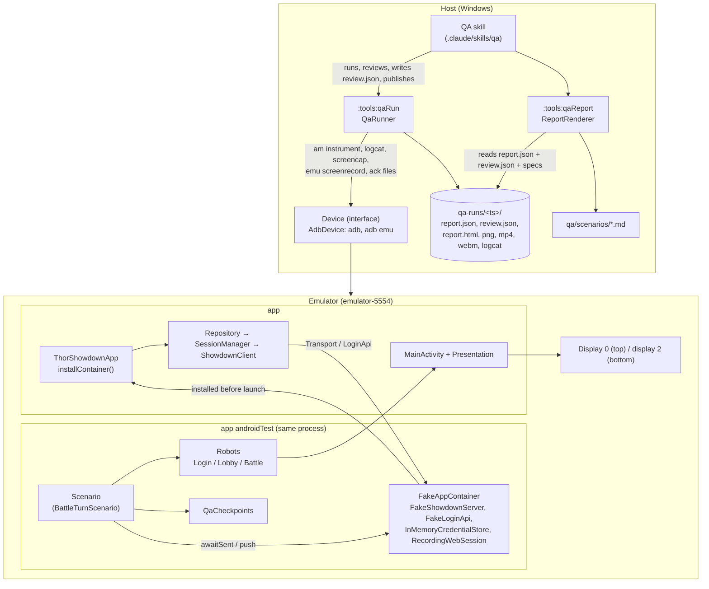
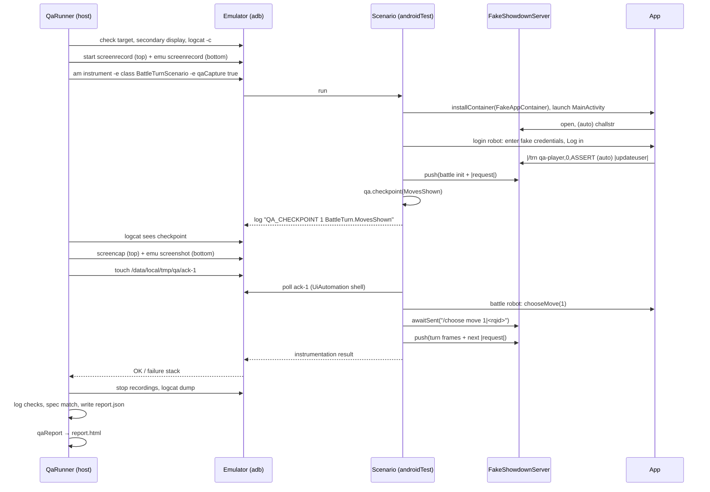
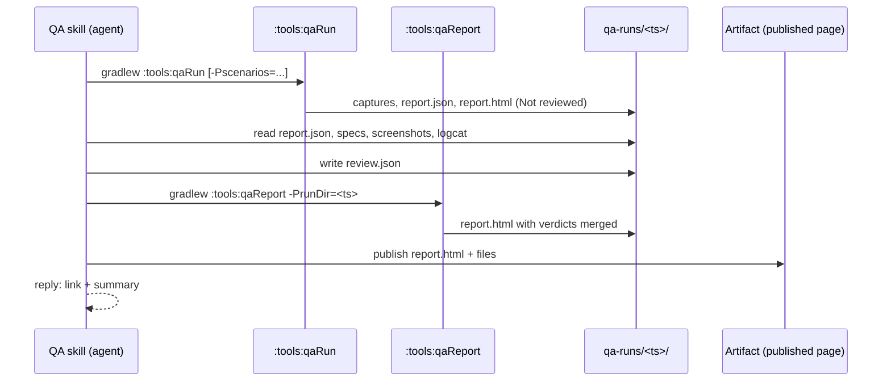

# Emulator Workflow Tests and QA Reports

Design for [#16 Emulator workflow tests and QA reports](https://github.com/jaydenfont/ThorShowdown/issues/16): workflow tests that run the real app on the emulator against a scripted
fake Showdown server, capture both screens and the logs, and produce an HTML report that a QA
agent can review and publish. Where it fits: [architecture.md](architecture.md).

## Purpose

Unit tests cover logic. Workflow tests cover the app as a user sees it: both displays, the real
Activity, `Presentation`, ViewModel, Repository, SessionManager and `ShowdownClient`, with only the
network and device storage replaced. Every run leaves evidence (screenshots per checkpoint, video
of both screens, logcat) and a self-contained report. An agent can add visual judgement to that
report, but the report is complete without it.

## Decisions

| Topic | Decision |
|---|---|
| Layers | Unit (existing, CI) → **hermetic workflow tests** (this doc, emulator, local only) → live smoke tests (later issue: guest bot challenges `thorshowdowntest`). |
| Target | The emulator only. The runner refuses any serial that isn't `emulator-*`, so a plugged-in Thor is never touched. |
| Fake server | A fake `Transport` + `LoginApi`, the client's only network seams. Login is answered automatically (challstr → `updateuser`); everything after is scripted by the test: `awaitSent(command)` then `push(frames)`. |
| Fakes location | `FakeShowdownServer` and `FakeLoginApi` move to `:showdown-client` **`java-test-fixtures`** (built-in Gradle plugin), used by the client's unit tests and `app/androidTest`. |
| Injection (architecture change) | New `AppContainer` interface: `transport`, `loginApi`, `credentialStore`, `webSession`. `ThorShowdownApp` builds the repository from the container `AppGraph` picks: `DefaultAppContainer` unless a test called `installContainer(...)` first; installing after the container is in use throws. `AppGraph` is a plain class so the rule is unit-tested without Android. Composition, no inheritance, no flavor. First step towards Hilt. |
| Hermetic state | `FakeAppContainer` uses an in-memory `CredentialStore` and a recording `WebSession`. No `pm clear`, so the emulator's saved login is untouched. One `am instrument` per scenario, so every scenario gets a fresh process and repository. |
| Top screen | The WebView still loads the real site for the fake room ("room doesn't exist"). Top checks are agent-judged only: status line, no Showdown controls visible. Making it hermetic (web origin in the container) is a later option. |
| Fixtures | Per-scenario frame files in `app/src/androidTest/assets/qa/`, cut from real transcripts, players renamed `qa-player` / `qa-opponent`. |
| Driving the UI | Scenarios → **robots** (`LoginRobot`, `LobbyRobot`, `BattleRobot`) → `TestTags` (one object, used by the composables). Robots use `createEmptyComposeRule()` plus `ActivityScenario.launch` (so the container is installed first); the Compose rule **does** reach the `Presentation`'s window and dialogs on either display, so no UI Automator is needed. Per-slot elements use tag functions (`TestTags.move(1)`, `partyMember(2)`, `switchIn(2)`). Scenarios never touch selectors, so UI redesigns (#8 main menu, #14 second activity) change robots only. |
| Checkpoints | Per-scenario enum (`BattleTurnCheckpoint.MovesShown`). `qa.checkpoint(c)` waits for Compose to be idle, then logs `QA_CHECKPOINT <n> <Name>` (one scenario per run, so the scenario is implied); with `qaCapture=true` it waits for `/data/local/tmp/qa/ack-<n>` (polled via `UiAutomation.executeShellCommand`), failing after 10 s. Without the argument it only logs, so tests run normally from Android Studio. |
| Runner | `:tools:qaRun` (`JavaExec`, depends on `:app:installDebug` + `:app:installDebugAndroidTest`). Per scenario: check target and secondary display → clear logcat → start both videos → `am instrument -w -e class <Scenario> -e qaCapture true` → capture both screens on each checkpoint and ack → stop videos → save logcat → run log checks → write results. `-Pscenarios=Login,BattleTurn`; default all. |
| Capture | Top: `adb exec-out screencap -p`, `adb shell screenrecord` (mp4, 3 min cap). Bottom: `adb emu screenrecord screenshot <dir> --display 1`, `adb emu screenrecord start --display 1 <file>.webm` (console display index 1 = Android display 2). |
| Secondary display | If missing: `adb emu multidisplay add 1 1240 1080 400 0` (Thor's bottom screen size). |
| Log checks | Deterministic, by the runner: canary values (fake password, sid, assertion, read from the tests' own `Canaries.kt`) anywhere in logcat, `FATAL EXCEPTION` in the app's process, and `ANR in <app>` each fail the scenario. Error-level lines from the app's process (pid from the `TestRunner` lines) are listed for the agent to review but don't fail it, because the emulator's renderer logs harmless errors from every app. |
| Specs | `qa/scenarios/<Scenario>.md`: purpose, then one heading per checkpoint enum name with the expected top and bottom screens. The runner reports any checkpoint without a heading, or heading without a checkpoint, as an error. |
| Output | `qa-runs/<yyyyMMdd-HHmmss>/` at the repo root (gitignored): `report.json`, `report.html`, `report.page.html`, and per scenario `checkpoints/NN-Name-{top,bottom}.png`, `top.mp4`, `bottom.webm`, `logcat.txt`, `instrument.txt`. |
| Report | One renderer, `:tools:qaReport <runDir>`, always run by `qaRun`. Static HTML, inline CSS, no JS dependencies, relative links (opens from disk, like Gradle's reports). Summary bar, scenario table, a card per scenario with checkpoints (top and bottom side by side, spec text, verdict), log-check hits, assertion failure, links to videos and logcat. Visual checks show **Not reviewed** until a review exists. Built with stdlib + an HTML-escape helper (no kotlinx.html); the stylesheet is a resource (`tools/src/main/resources/qa/report.css`, light and dark). Two outputs from the same content: `report.html` is a complete document for opening from disk; `report.page.html` has no `<html>`/`<head>`/`<body>` skeleton, for publishing as an artifact. The spec text is copied into `report.json`, so a run folder stands alone. |
| Agent review | The QA skill writes `review.json` (verdict `Pass` / `Fail` / `NeedsHuman`, reason, per scenario/checkpoint/screen) and re-runs `qaReport`, which merges it. The agent never edits HTML, tests or specs. |
| Publishing | The QA skill publishes `report.page.html` with the screenshots and test-runner outputs as a private multi-file artifact and replies with the link. Logcat files and videos stay local: they are large and the agent publishes only what it has read. |
| QA skill | `.claude/skills/qa/SKILL.md` in the repo: run → read report and specs → review screenshots and logs → `review.json` → re-render → publish → summary. Exploratory adb-driven runs are later. |
| First scenarios | `Login`, `SearchAndCancel`, `BattleTurn` (moves, choose + undo, switch, forced switch after a faint), `ForfeitAndLeave`. Timer, long-press descriptions and network loss follow. |
| CI | Unchanged: `:tools` unit tests run in `test`. Scenarios and `qaRun` are local only. |

## Architecture



## Sequences

### One scenario with a checkpoint



### Agent review



## Code examples

### Composition root (app)

```kotlin
/** What the network and device provide. Tests install a fake before the repository exists. */
interface AppContainer {
    val transport: Transport
    val loginApi: LoginApi
    val credentialStore: CredentialStore
    val webSession: WebSession
}

/** Picks the container: the default, unless another was installed before first use. */
class AppGraph(private val defaultContainer: () -> AppContainer) {
    val container: AppContainer
        @Synchronized get() = chosen ?: (installed ?: defaultContainer()).also { chosen = it }

    @Synchronized
    fun install(replacement: AppContainer) {
        check(chosen == null) { ALREADY_IN_USE }
        installed = replacement
    }
}

class ThorShowdownApp : Application() {
    private val graph = AppGraph { DefaultAppContainer(this, config) }

    val repository by lazy {
        val container = graph.container
        val client = DefaultShowdownClient(config, container.transport, container.loginApi, applicationScope)
        ShowdownRepository(client, LocalDataSource(container.credentialStore), container.webSession, applicationScope)
    }

    fun installContainer(container: AppContainer) = graph.install(container)
}
```

### Fake server additions (test fixtures)

```kotlin
class FakeShowdownServer : Transport {
    /** Answers the login handshake like the real server: challstr on open, updateuser on /trn. */
    fun autoLogin(username: String) { /* ... */ }

    /** Suspends until the client sends a message ending in [command] (rqid-agnostic), or times out. */
    suspend fun awaitSent(command: String, timeout: Duration = 5.seconds): String { /* ... */ }
}
```

### A scenario

```kotlin
class BattleTurnScenario {
    @get:Rule val qa = QaRule()   // installs FakeAppContainer, launches MainActivity

    @Test
    fun BattleTurn_ChooseUndoSwitchAndForcedSwitch_SendsEachChoice() =
        runBlocking {
            qa.logInToLobby()
            Fixture.BattleStart.pushTo(qa.server)
            qa.battle.assertMovesShown(count = MOVE_COUNT)
            qa.checkpoint(BattleTurnCheckpoint.MovesShown)

            qa.battle.chooseMove(1)
            qa.server.awaitSent(MOVE_1)
            qa.battle.assertWaitingWithUndo()
            qa.checkpoint(BattleTurnCheckpoint.ChoiceSent)
            // ... undo, switch to Lucario, LucarioFaints, forced switch, TurnTwo
        }
}

enum class BattleTurnCheckpoint { MovesShown, ChoiceSent, PartyOpen, ForcedSwitch, TurnTwo }
```

### Spec (`qa/scenarios/BattleTurn.md`)

```markdown
# BattleTurn
Choose a move, undo it, switch, then handle a forced switch after a faint.

## MovesShown
- Bottom: battle header, four move tiles with PP, Tera toggle, Party and Forfeit buttons.
- Top: status line for the room; no Showdown move or switch controls visible.

## UndoneBackToChoose
- Bottom: move tiles enabled again, no "Waiting" banner.
```

### Runner (tools)

```kotlin
/** What the runner needs from the emulator; AdbDevice uses adb, FakeDevice backs the unit tests. */
interface Device {
    fun prepare()
    fun startRecording(scenarioDir: File): Recording
    fun logcat(): LogStream
    fun instrument(testClass: String): RunningInstrument
    fun screenshotTop(to: File)
    fun screenshotBottom(to: File)
    fun ack(index: Int)
}

class ScenarioRunner(private val device: Device, private val logChecks: LogChecks, private val testPackage: String) {
    fun run(spec: ScenarioSpec, dir: File): ScenarioReport {
        device.prepare()
        val recording = device.startRecording(dir)
        val session = observe(spec.name, dir)   // logcat → checkpoint → screenshots → ack, until the test ends
        val videos = recording.stop()
        return report(spec, dir, session, videos)  // log checks, spec matching, files
    }
}
```

### Review file

```json
{
  "reviewer": "qa-skill",
  "scenarios": {
    "BattleTurn": {
      "checkpoints": {
        "MovesShown": {
          "bottom": { "verdict": "Pass", "reason": "Four tiles with PP, Tera toggle present." },
          "top": { "verdict": "NeedsHuman", "reason": "Room-not-found page; controls hidden." }
        }
      }
    }
  }
}
```

## Test seams

| Seam | Tests |
|---|---|
| `FakeShowdownServer` / `FakeLoginApi` (test fixtures) | Auto-login handshake; `awaitSent` matches and times out. |
| `AppGraph` | Default used when nothing is installed; installed container used; installing after use throws. |
| `:tools` runner logic behind `Device` (with `FakeDevice`) | Logcat and checkpoint parsing; captures then ack per checkpoint, ack even when a screenshot fails; canary, crash and ANR detection; error lines listed, not failed; spec matching both ways; `am instrument` results; target check refuses non-emulators; scenario selection; canaries read from `Canaries.kt`. |
| `ReportRenderer` / `QaRun.rerender` | Complete document and page variant; Not reviewed without a review; review merged on re-render; HTML escaping; missing captures shown as missing; relative links. |
| Scenarios | The app end to end on the emulator (run by hand via `qaRun`). |

## Files

- `showdown-client/src/testFixtures/...`: `FakeShowdownServer`, `FakeLoginApi` (moved), auto-login, `awaitSent`.
- `app/src/main/.../AppContainer.kt` (with `DefaultAppContainer`), `AppGraph.kt`; `ThorShowdownApp` uses them; `ui/TestTags.kt`.
- `app/src/androidTest/.../qa/`: `QaRule`, `QaCheckpoints`, `Canaries`, `FakeAppContainer`, `Fixture`, `robots/`, `scenarios/`; `assets/qa/` fixtures.
- `tools/src/main/.../qa/`: `Device`, `AdbDevice`, `ScenarioRunner`, `QaRun`, `LogcatLine`, `LogChecks`, `ScenarioSpec`, `InstrumentResult`, `CanarySource`, `Report`, `Review`, `ReportRenderer`, `QaRunMain`, `QaReportMain`; `resources/qa/report.css`; tasks `qaRun`, `qaReport`.
- `qa/scenarios/*.md`; `.claude/skills/qa/SKILL.md`; `.gitignore` adds `/qa-runs`.
- Docs: `architecture.md` (AppContainer, test layers), `CLAUDE.md` (commands), `context/README.md`, `workplan.md`.

## Risks

- **Live site in the top screen**: the WebView loads `play.pokemonshowdown.com` for the fake room, using
  whatever cookies the emulator's WebView already holds (the real test account's, if it logged in before).
  It only views, but it is a live connection during a hermetic run. A later option: put the web origin
  in the container and point it at `about:blank` or a local page in workflow tests.
- **Emulator console paths** can't contain spaces, so console captures go to a staging folder under the
  system temp directory first.
- **Emulator console commands** (`adb emu screenrecord`, `multidisplay`) are emulator-version specific;
  the runner fails with a clear message if one is rejected.
- **Checkpoint timing**: captures happen while the test waits, but animations may still be running;
  robots wait for idle before each checkpoint.
- **Top screen** depends on the real site in hermetic runs, so its verdicts stay agent-judged.
